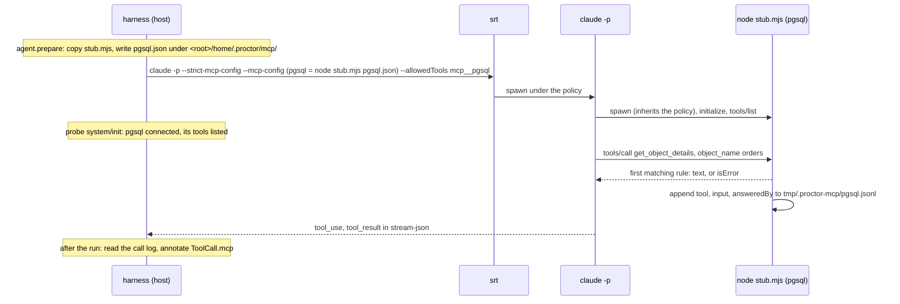

# Design: MCP stubs

| | |
|---|---|
| Status | proposal, not implemented; to be validated before any code |
| Date | 2026-11-10 |
| Scope | the **tools** capability of MCP servers, stdio transport, `claude-code` adapter first |
| Verified on | Claude Code 2.1.286, `@anthropic-ai/sandbox-runtime` 0.0.78, macOS |

The authoring examples below are fenced as `typescript`, not `ts`: `test/docs.test.ts` compiles every `ts` block that imports `@fluce/proctor`, and this API does not exist yet. The implementation pull requests turn them into `ts` blocks of the reference pages.

## Problem

A skill often grounds its answer in an MCP server: a database, a ticket tracker, an observability backend. In an eval, the workspace holds a diff or a repository, and that server does not exist. Every step of the skill that reads the server is never measured.

Example: a SQL review skill must call `get_object_details` on a `pgsql` MCP server before it calls an index missing on `orders`, and read the size of the table before it calls a lock a blocker. Today, an eval of that skill only measures what the model guesses from the diff.

The suite author wants to declare, per case, what the server would have answered ("`orders` holds 180M rows, the index on `customer_id` exists"), and to measure that the agent calls the right tools and uses their answers.

## Goals and non-goals

| Goal | Non-goal |
|---|---|
| Declare a fake MCP server, its tools and its canned answers in a `*.eval.ts` | resources, prompts, sampling, elicitation, notifications |
| Answers per case, presence per variant (ablation: with and without the server) | the HTTP and SSE transports |
| Stay inside the trial sandbox: no network, no host file | record and replay of a real server (see [future work](#future-work)) |
| Grade the calls: which tool, with which input, how many times | simulating latency, timeouts, server crashes |
| Free in a dry run (`--agent fake`), zero model cost for the stub | validating tool inputs against `inputSchema` |

## What exists today

Facts read in the code at `origin/main` (`07a4a55`).

| Fact | Where |
|---|---|
| A variant already carries raw MCP servers, `Record<string, unknown>`, opaque to the core | `src/core/model.ts:33`, `src/dsl/variant.ts:52-54` |
| They reach the adapter as `AgentRunInput.mcpServers` | `src/ports/agent.ts:17-18`, `src/core/lifecycle.ts:130-134` |
| The adapter always passes `--strict-mcp-config --mcp-config '<inline JSON>'` | `src/adapters/agents/claude-code/flags.ts:38-40` |
| `readonly` permissions are `--permission-mode dontAsk --tools Read` | `src/adapters/agents/claude-code/flags.ts:16` |
| The isolation probe kills the run when `system/init` lists an undeclared MCP server or `mcp__*` tool; declared means a key of `mcpServers` | `src/adapters/agents/claude-code/init-probe.ts:35-44`, `adapter.ts:119` |
| Tool names are `mcp__<server>__<tool>`, the server name normalized to `[A-Za-z0-9_-]` | `src/adapters/agents/claude-code/init-probe.ts:24` |
| Under srt, MCP servers spawned by `claude` inherit the policy: host home and host temp hidden, only `work/`, `home/`, `tmp/` of the trial and the agent binary directory readable | `src/adapters/sandboxes/srt/sandbox.ts:34-37`, `srt/config.ts:44-54`, `adapter.ts:70` |
| The agent `PATH` drops every entry under the host home | `src/adapters/sandboxes/temp-layout.ts:62-66` |
| `tool_use` and `tool_result` blocks become `ToolCall { name, input, output, isError }` | `src/adapters/agents/claude-code/stream-parser.ts:148-158` |
| `toolUsed` matches a tool name and a regex over the JSON of the input | `src/graders/tool-calls.ts:24-26`, `src/graders/tool-used.ts:19-31` |
| The judge sees the final answer and the diff, never the tool calls | `src/graders/llm-judge.ts:173` |
| `--agent fake` with a real sandbox runs one shell command through `workspace.wrap` | `src/cli/registry.ts:36-41`, `src/adapters/sandboxes/probe.ts` |

## Spike results

A zero-dependency stdio server (about 40 lines of Node) and a local fake of the Messages API (`ANTHROPIC_BASE_URL=http://127.0.0.1:<port>`, fake key) drove the real `claude` binary through a full tool call. No request left the machine: no model was billed.

| Question | Observed |
|---|---|
| Does an inline `--mcp-config` stdio server load under `--strict-mcp-config`? | yes: `system/init` lists `{"name":"pgsql","status":"connected","source":"dynamic"}` and the tool `mcp__pgsql__get_object_details` |
| Handshake the server must answer | `initialize`, then the notification `notifications/initialized`, then `tools/list`, then `tools/call`; nothing else was sent |
| Does `--tools Read` hide MCP tools? | no: the request carries `Read` and the MCP tool |
| Can `readonly` call the stub? | no: `dontAsk` denies it (`Permission to use mcp__pgsql__get_object_details has been denied because Claude Code is running in don't ask mode`) |
| What allows it? | either `--allowedTools mcp__pgsql` or `--settings '{"permissions":{"allow":["mcp__pgsql__get_object_details"]}}'`; both verified |
| What reaches the stream? | `tool_use` with the input, `tool_result` with the text; `isError: true` from the server becomes `"is_error": true` |
| Does it run under the srt policy of a trial? | yes: node from `/usr/local/bin`, the stub and its config copied under `<root>/home/.proctor/mcp/`, host home and temp hidden; `connected`, tool called, answer received |
| A plugin whose `.mcp.json` declares a server, under `--strict-mcp-config` | the plugin loads, its server **never starts**, whatever its name (`pgsql` or `other`) |
| The same plugin without `--strict-mcp-config` | its server is named `plugin:<plugin>:<server>` (`"source":"plugin"`), its tools `mcp__plugin_<plugin>_<server>__<tool>` |
| Can a stub take the name of a plugin's server? | yes: a `--mcp-config` server named `plugin:dbtools:pgsql` exposes `mcp__plugin_dbtools_pgsql__get_object_details`, and `--allowedTools mcp__plugin_dbtools_pgsql` allows it |
| 15 tools with long descriptions | all sent to the model directly, none deferred behind a tool search |

Consequence: proctor already drops the MCP servers of every plugin it loads. A stub cannot collide with one; it replaces it by construction, and takes its name when the skill names its tools in full.

## Mechanics



| Point | Proposal | Why |
|---|---|---|
| Transport | stdio, one process per stub server per trial, spawned by `claude` | spawned by the agent, it inherits the srt policy: no network, no port, nothing to open in the sandbox |
| Stub program | one self-contained ES module, `src/adapters/mcp-stub/stub-server.mjs`, Node built-ins only, `// @ts-check` with JSDoc types | Node 22.12 cannot run `.ts` without a flag; no `node_modules` to make readable inside the sandbox |
| Where it lives during a trial | copied by `prepare` to `<root>/home/.proctor/mcp/stub.mjs` | the package often sits under the hidden host home; the trial home is readable |
| Node binary | `process.execPath`, the node that runs proctor (>= 22.12), by absolute path | the sandbox `PATH` drops entries under the host home (nvm, fnm, volta) |
| Sandbox access | the adapter adds `dirname(process.execPath)` to its `sandboxAccess.readablePaths`, like the `claude` binary | node installed under the host home is otherwise hidden |
| Configuration | one JSON file per server, `<root>/home/.proctor/mcp/<server>.json`, written by `prepare` (outside the sandbox) | data, not code: see [serializability](#serializability); a file keeps the `--mcp-config` argument small (an argument is capped at 128 KiB on Linux, `flags.ts:22-24`) |
| `--mcp-config` | the variant's `mcpServers` plus one entry per stub: `{ type: "stdio", command: <node>, args: [<stub.mjs>, <server>.json, <call log>] }` | the flag already exists and stays strict |
| Permissions | `--allowedTools mcp__<normalized server>` per stub, whatever the permission level | a stub has no side effect: `readonly` must be able to call it, otherwise `dontAsk` denies every call |
| Isolation probe | stubs count as declared servers; a stub not `connected` in `system/init`, or a declared tool missing from `tools`, stops the run (`other`) with the cause | a stub that failed to start would silently measure the skill without the server |
| Call log | the stub appends `{ tool, input, answeredBy, rule }` to `<root>/tmp/.proctor-mcp/<server>.jsonl`; the adapter reads it after the run and annotates the matching tool calls | tells a call the case anticipated from one answered by the fallback, without parsing the answer text |
| Tool names seen by Claude | `mcp__<server>__<tool>`; `mcp__plugin_<plugin>_<server>__<tool>` for a stub that takes a plugin's server name | Claude Code's convention, verified |
| A plugin that declares the same server | nothing to do: `--strict-mcp-config` never starts it (verified); `mcpStub("pgsql").ofPlugin("dbtools")` names the stub `plugin:dbtools:pgsql` when the skill names its tools in full | the stub replaces the plugin's server with the same tool names |

The stub answers `initialize` (capabilities `{ tools: {} }`, echoing the client's protocol version), `ping`, `tools/list` and `tools/call`, ignores notifications, and answers `-32601` to any other method. `tools/call` on an undeclared tool returns an `isError` result: Claude only calls listed tools, so this only guards against a stale config.

### Who does what

| Layer | Change |
|---|---|
| `core/model.ts` | `McpStubDefinition` (server, tools, rules, fallback) as plain serializable data, on `VariantDefinition.mcpStubs`; case rules on `CaseDefinition.mcpStubRules`; zod schemas and cross-checks in `suiteSchema` |
| `core/` | a pure `stubsFor(variant, testCase)` that merges case rules into the variant's stubs, called by `agentSetup` (`lifecycle.ts:130`) |
| `ports/agent.ts` | `AgentRunInput.mcpStubs: readonly McpStubDefinition[]`; `ToolCall.mcp?: { server, tool, answeredBy }` |
| `dsl/` | `mcpStub()` builder, `VariantBuilder.mcpStub()`, `CaseBuilder.mcpStub()` |
| `adapters/mcp-stub/` | `stub-server.mjs` (protocol and matching), `materialize.ts` (copies the script, writes configs, returns the `--mcp-config` entries, reads the call logs); shared by every adapter |
| `adapters/agents/claude-code/` | `prepare` materializes, `flags.ts` adds entries and `--allowedTools`, `init-probe.ts` checks `connected` and tools, `run` annotates `ToolCall.mcp` |
| `graders/`, `ports/grader.ts` | `mcpCalled()`; `GradeContext.mcpStubs`, the names of the stubs of the trial |
| `testing/`, `cli/registry.ts` | the fake agent handshakes each stub through the sandbox; `answerStub()` for tests |
| `reporters/` | per-trial counts in the CTRF, a warning when the fallback answered |

MCP is a protocol, not an agent: the core and the ports carry stubs as agent-neutral data, the way they already carry `mcpServers`. Adding OpenCode adds an adapter that writes its own MCP config from the same materialized entries: no diff in `core/` or `ports/`.

## Authoring API

### The whole shape

```typescript
import { mcpCalled, mcpError, mcpStub, suite } from "@fluce/proctor"

// The server as the agent sees it: tools, descriptions, input schemas, and answers shared by every case.
const pgsql = mcpStub("pgsql")
  .tool("list_instances", (t) =>
    t.description("Lists the PostgreSQL instances you can query.").inputSchema({ type: "object", properties: {} }).returns({ instances: ["prod"] }),
  )
  .tool("get_object_details", (t) =>
    t.description("Columns, nullability, constraints and indexes of a table.").inputSchema({
      type: "object",
      properties: { instance: { type: "string" }, schema: { type: "string" }, object_name: { type: "string" } },
      required: ["instance", "object_name"],
    }),
  )
  .otherwise(mcpError("relation does not exist"))

const ORDERS_WITH_INDEX = { table: "public.orders", indexes: ["orders_pkey (id)", "orders_customer_id_idx (customer_id)"] }

export default suite("sql-review")
  .variant("with-pgsql", (v) => v.mcpStub(pgsql).prompt((c) => `Review change.diff as a DBA.\n\n${c.context}`))
  .case("index-exists", (c) =>
    c
      .mcpStub(pgsql, (s) => s.on("get_object_details", { object_name: "orders" }).returns(ORDERS_WITH_INDEX))
      .expect(mcpCalled("reads-orders", pgsql, { tool: "get_object_details", input: { object_name: "orders" } })),
  )
```

| Builder | Methods | Returns |
|---|---|---|
| `mcpStub(name)` | `.tool(name, t => …)`, `.otherwise(response)`, `.ofPlugin(plugin)` | `McpStub<Tools>`, immutable; `Tools` is the union of the declared tool names |
| tool `t` | `.description(text)`, `.inputSchema(jsonSchema)`, `.returns(r)`, `.fails(text)`, `.on(when).returns(r)` / `.fails(text)` / `.returnsInOrder(...r)`, `.otherwise(response)` | tool builder |
| variant `v` | `.mcpStub(stub)`, repeatable | `VariantBuilder` |
| case `c` | `.mcpStub(stub, s => s.on(tool, when?).returns(r) …)`, repeatable | `CaseBuilder` |
| case rules `s` | `.on(tool: Tools, when?)` then `.returns(r)`, `.fails(text)` or `.returnsInOrder(...r)` | `McpStubRules<Tools>`; a dangling `.on()` without an answer does not compile |
| helpers | `mcpError(text)`: an `isError` answer, usable in `.returns`, `.returnsInOrder`, `.otherwise` | `McpStubResponse` |
| grader | `mcpCalled(id, stub, { tool?, input?, answeredBy? }, { min?, max? })`, the shape of `toolUsed(id, match, count)` | `Grader` |

`.returns(r)` on a tool is shorthand for `.on().returns(r)`: an answer to any input.

### Levels and merge rules

| What | Level | Rule |
|---|---|---|
| The server exists in the trial | variant: `v.mcpStub(pgsql)` | a variant without it runs without the server: two variants measure the skill with and without it |
| Tools, descriptions, input schemas | the `mcpStub()` value | one catalog, shared; the case cannot add a tool |
| Answers shared by every case | the `mcpStub()` value: `t.returns(...)`, `t.on(...)` | e.g. `list_instances` always answers `prod` |
| Answers of one case | case: `c.mcpStub(pgsql, s => …)` | apply only in the variants that declare `pgsql`; ignored in the others |
| Fallback | `t.otherwise(...)`, else `mcpStub().otherwise(...)`, else built in | built in: `isError`, text `No result for these arguments.` |

Resolution of one call `(server, tool, input)`, first match wins:

1. the case rules for that tool, in declaration order;
2. the rules of the `mcpStub()` value for that tool, in declaration order;
3. the tool's `otherwise`, then the server's, then the built-in fallback.

Checks at `toDefinition()`, each with a message that says what to do:

| Problem | Message |
|---|---|
| a case answers for a server no variant declares | `case "x" > mcpStub "pgsql": no variant declares this MCP stub; add .mcpStub(pgsql) to a variant` |
| a case answers for a tool the variant's stub of that name lacks (two different `mcpStub("pgsql")` values) | `case "x" × variant "y" > mcpStub "pgsql": no tool "explain_query"` |
| a stub and a raw `.mcpServers()` entry share a name, or two stubs normalize to the same tool prefix | `variant "y": "pgsql" is declared twice; rename one` |
| a matcher holds a function, a class instance, `undefined` or a non-JSON value | `case "x" > mcpStub "pgsql" > get_object_details > rule 1: predicates cannot cross to the stub process; use an object pattern or a RegExp` |
| a server or tool name outside `[A-Za-z0-9_-]` (`:` allowed only through `.ofPlugin`) | the allowed characters |

### Matching an input

| `when` | Matches | Example |
|---|---|---|
| omitted | any input | `.on("list_instances")` |
| object pattern | every key of the pattern is in the input and matches, recursively; extra input keys are ignored | `{ object_name: "orders" }` |
| `RegExp` as a value | a string field it matches (`search`) | `{ object_name: /^(public\.)?orders$/i }` |
| array as a value | same length, element by element | `{ columns: ["customer_id"] }` |
| `RegExp` as `when` | the JSON of the whole input, as `toolUsed` does | `.on("execute_sql", /reltuples/)` |

The same pattern type serves the `input` of `mcpCalled`: what a case answers and what it expects read the same.

### Answers

| Call | The agent receives |
|---|---|
| `.returns("text")` | `content: [{ type: "text", text }]` |
| `.returns({ … })` or an array, number, boolean | the value as pretty JSON text, which is what most servers return |
| `.fails("text")`, `.returns(mcpError("text"))` | the same text with `isError: true` |
| `.returnsInOrder(a, b, mcpError("c"))` | `a` to the first matching call, `b` to the second, then `c` for every later one |

A large answer, an `EXPLAIN` plan for instance, is read by the suite itself: `.returns(await readFile(new URL("./plan.txt", import.meta.url), "utf8"))`.

### Serializability

The stub runs in another process, inside the sandbox: a closure cannot cross. The proposal keeps every rule declarative.

| Option | For | Against | Decision |
|---|---|---|---|
| Declarative matchers (object pattern, `RegExp`) and static answers | JSON plus `{ "$regex": source, "flags": flags }`; validated at load time; deterministic; the same matcher grades | no computed answer | **v1** |
| A handler module loaded by the stub (`.handledBy(new URL("./handler.mjs", import.meta.url))`) | any logic, e.g. a fake SQL engine | the module and its imports must be readable in the sandbox; the agent can read it; harder to keep deterministic | later, if a suite needs it: a single-file ES module, no import, copied into the trial |
| The stub calls back the harness (socket, HTTP) to run a JS predicate | full closures | opens a channel out of the sandbox, the very thing srt closes | rejected |

Types refuse functions (`JsonPattern` has no function member) and zod refuses them at load time for suites written in JS.

### Input schemas

| Option | For | Against | Decision |
|---|---|---|---|
| JSON Schema object | what MCP sends on the wire; copy it verbatim from the real server's `tools/list` | untyped in TS | **v1**; omitted means `{ "type": "object" }` |
| zod schema, converted with `z.toJSONSchema` (zod 4 is already a dependency) | typed `when` patterns | a second way; a conversion that may differ from the real server | later |

The stub does not validate inputs against the schema: Claude already shapes them from it, and a validator would be a dependency. Fidelity matters more: the model chooses tools from their descriptions and schemas, so copy them from the real server.

## Graders and the judge

| Need | Today, without new code | Proposed |
|---|---|---|
| The agent called a tool | `toolUsed("reads-orders", { tool: "mcp__pgsql__get_object_details" })` | `mcpCalled("reads-orders", pgsql, { tool: "get_object_details" })` |
| … with a given input | `input: /"object_name":"(public\.)?orders"/` over the JSON | `input: { object_name: /^(public\.)?orders$/ }`, the matcher of the stub |
| … a number of times | `toolUsed(…, { min, max })` | `mcpCalled(…, { min, max })`, same `CallCount` |
| The agent never asked what the case did not anticipate | not possible: the fallback text is all there is | `mcpCalled("all-anticipated", pgsql, { answeredBy: "fallback" }, { min: 0, max: 0 })` |

- `mcpCalled` reads `ToolCall.mcp`, which the adapter fills from the call log: it does not know `mcp__…` naming, so it stays agent-neutral, and the tool name is typed from the stub value.
- In a trial whose variant has no stub of that name, `mcpCalled` is not applicable: `passed: true, criteria: []`, the rule of the [boundaries](https://github.com/Luce-Florian/proctor/blob/main/CLAUDE.md#boundaries). It reads the stubs of the trial from a new `GradeContext.mcpStubs` (names only). A variant without the server is then measured by the judge criteria, not failed by construction.
- `toolUsed` keeps working on `mcp__pgsql__…`, as it works on `Read` or `Bash`: a suite can start without `mcpCalled`.
- The judge sees the final answer and the diff only (`llm-judge.ts:173`). The case author knows what the stub answers: the criteria state those facts ("`get_object_details` reports an index on `orders(customer_id)`; the answer does not ask for one"). The judge then checks the answer against the criterion, not against a tool output the agent could have shaped.

## Dry run, fake agent, reports, cost

| Topic | Proposal |
|---|---|
| `--agent fake --sandbox srt` | after `probeSandbox`, the fake agent materializes the stubs and runs, through `workspace.wrap`, an `initialize` + `tools/list` handshake with each one: node readable, config valid, tools listed, for free. A failure ends the trial `other` with `The MCP stub "pgsql" did not start in the sandbox: …` |
| `--agent fake` alone (fake sandbox) | the configs are validated in process, nothing is spawned |
| `proctor list` | shows the stubs of each variant, e.g. `with-pgsql  mcp stubs: pgsql (2 tools)` |
| Tests | `@fluce/proctor/testing` exports `answerStub(input.mcpStubs, "pgsql", "get_object_details", input)`: a `FakeAgentAdapter` reply returns the `ToolCall` the stub would have produced, with its `mcp` annotation, so graders are tested without `claude` |
| CTRF | per test, `extra.mcpStubCalls` (calls a stub answered) and `extra.mcpStubFallbacks` (calls answered by a fallback); no input, no output: a verdict and a report never hold tool data |
| Summary, HTML, console | a note on each trial whose `mcpStubFallbacks > 0`: the agent asked something the case did not anticipate; the case may need a rule |
| Transcripts | unchanged: the stream already holds every `tool_use` and `tool_result` |
| Cost | the stub is a local Node process, no model; the agent pays the tokens of the tool definitions and answers, as with a real server |

## End-to-end example

A SQL review skill, two cases on the same kind of change: an index that exists and one that does not. Same diff shape, different server answers, different expected verdict: the pair measures that the skill reads the server instead of guessing.

```typescript
// evals/sql-review.eval.ts
import { fileURLToPath } from "node:url"
import { type CaseBuilder, directory, judge, limits, mcpCalled, mcpError, mcpStub, suite } from "@fluce/proctor"

const PLUGIN = fileURLToPath(new URL("../plugins/sql-review", import.meta.url))
const JUDGE_MODEL = "claude-sonnet-5"
const INSTANCE = { type: "string", description: "Instance name, from list_instances." }

/** The server as the skill expects it; descriptions and schemas copied from the real server's tools/list. */
const pgsql = mcpStub("pgsql")
  .tool("list_instances", (t) =>
    t
      .description("Lists the PostgreSQL instances you are granted.")
      .inputSchema({ type: "object", properties: {} })
      .returns({ instances: [{ name: "prod", version: "16.4" }] }),
  )
  .tool("get_object_details", (t) =>
    t
      .description("Columns, nullability, constraints and indexes of a table or a view.")
      .inputSchema({
        type: "object",
        properties: { instance: INSTANCE, schema: { type: "string" }, object_name: { type: "string" } },
        required: ["instance", "object_name"],
      })
      .otherwise(mcpError("relation does not exist")),
  )
  .tool("execute_sql", (t) =>
    t
      .description("Runs a read-only SQL statement. Statements are cut at 30 s.")
      .inputSchema({ type: "object", properties: { instance: INSTANCE, sql: { type: "string" } }, required: ["instance", "sql"] })
      .otherwise(mcpError("permission denied: only catalog queries are allowed on this instance")),
  )

const ORDERS_COLUMNS = [
  { name: "id", type: "bigint", nullable: false },
  { name: "customer_id", type: "bigint", nullable: false },
  { name: "created_at", type: "timestamptz", nullable: false },
]

/** What the two cases share: a workspace holding change.diff, the context, the call of get_object_details on orders, a budget. */
const reviewCase = (dir: string) => (c: CaseBuilder<"without-expectation">) =>
  c
    .fixture(directory(new URL(dir, import.meta.url)))
    .context("change.diff adds a query on orders filtered by customer_id.")
    .expect(mcpCalled("reads-orders", pgsql, { tool: "get_object_details", input: { object_name: /^(public\.)?orders$/ } }))
    .expect(mcpCalled("all-anticipated", pgsql, { answeredBy: "fallback" }, { min: 0, max: 0 }))
    .expect(limits().maxCostUsd(2))

const PROMPT = (c: { context: string }) => `/sql-review:review change.diff\n\n${c.context}`

export default suite("sql-review")
  .variant("with-skill", (v) => v.plugins(PLUGIN).mcpStub(pgsql).prompt(PROMPT))
  .variant("with-skill-no-server", (v) => v.plugins(PLUGIN).prompt(PROMPT))
  .case("orders-by-customer-index-exists", (c) =>
    reviewCase("./cases/index-exists/")(c)
      .mcpStub(pgsql, (s) =>
        s
          .on("get_object_details", { object_name: /^(public\.)?orders$/ })
          .returns({
            table: "public.orders",
            columns: ORDERS_COLUMNS,
            indexes: [
              { name: "orders_pkey", definition: "PRIMARY KEY (id)" },
              { name: "orders_customer_id_idx", definition: "btree (customer_id)" },
            ],
          })
          .on("execute_sql", /reltuples/)
          .returns([{ relation: "public.orders", estimated_rows: 180_000_000, total_size: "48 GB" }]),
      )
      .expect(
        judge()
          .model(JUDGE_MODEL)
          .criterion("approves", "Approves the query: no blocker", { principal: true })
          .decoy(
            "decoy-asks-existing-index",
            "Asks for an index on orders(customer_id), which get_object_details reports as orders_customer_id_idx",
          ),
      ),
  )
  .case("orders-by-customer-index-missing", (c) =>
    reviewCase("./cases/index-missing/")(c)
      .mcpStub(pgsql, (s) =>
        s
          .on("get_object_details", { object_name: /^(public\.)?orders$/ })
          .returns({ table: "public.orders", columns: ORDERS_COLUMNS, indexes: [{ name: "orders_pkey", definition: "PRIMARY KEY (id)" }] })
          .on("execute_sql", /reltuples/)
          .returns([{ relation: "public.orders", estimated_rows: 180_000_000, total_size: "48 GB" }]),
      )
      .expect(mcpCalled("reads-size", pgsql, { tool: "execute_sql", input: /reltuples|pg_total_relation_size/ }))
      .expect(
        judge()
          .model(JUDGE_MODEL)
          .criterion(
            "index-concurrently",
            "Asks for CREATE INDEX CONCURRENTLY on orders(customer_id), backed by the size the server reports (about 180M rows)",
            { principal: true },
          )
          .decoy("decoy-invented-size", "States a table size other than the one the server reports"),
      ),
  )
```

What each piece measures:

| Grader | In `with-skill` | In `with-skill-no-server` |
|---|---|---|
| `reads-orders`, `reads-size` | the skill read the table before concluding about its indexes and its size | not applicable: no `pgsql` stub in the trial ([open question 2](#open-questions)) |
| `all-anticipated` | the cases answer everything the skill asked; a failure points at a missing rule, not at the skill | not applicable |
| `approves` + `decoy-asks-existing-index` | the skill used the answer, not a reflex "add an index on the foreign key" | the skill guesses: the decoy measures how often it asks for an index that exists |
| `index-concurrently` + `decoy-invented-size` | the blocker is grounded in the reported size | the skill has no size: a principal it can only meet by a conditional verdict |

The judge criteria state what the stub answers, so the judge needs no tool output. The gap between the two variants is the value of the server to the skill.

## Options considered

### Where the server is declared

| Option | For | Against |
|---|---|---|
| Case only: `c.mcpStub(...)` makes the server present in every variant, `v.withoutMcpStub("pgsql")` opts out | one place | the ablation is an exception to write; a variant no longer says what the agent has |
| Suite: `suite().mcpStub(pgsql)` | one line for all variants | a third level; same opt-out problem |
| **Variant declares presence, the stub value holds the catalog, the case holds its answers** | matches `.plugins()` and `.mcpServers()`: the variant is what changes between two measures (`model.ts:28`); the ablation is a variant; answers stay with the case they ground | two calls to write |

Recommended: the third. A suite whose variants all have the server adds `.mcpStub(pgsql)` in the helper that builds them.

### How the stub is reached

| Option | For | Against |
|---|---|---|
| **stdio, spawned by `claude`** | inside the sandbox by inheritance, no network, verified | the stub and the agent share the sandbox: the agent can read the config |
| HTTP on loopback, served by the harness outside the sandbox | config unreadable by the agent; closures possible | opens loopback through srt (`allowLocalBinding` or an IP literal in `allowedDomains`); a port per trial; a server to stop |
| The proctor CLI as the stub (`node bin/proctor.js mcp-stub`) | no extra file | `tsx` and `node_modules` must be readable inside the sandbox, often under the hidden home |

Recommended: stdio with a self-contained `.mjs`.

### Graders

| Option | For | Against |
|---|---|---|
| `toolUsed` on `mcp__pgsql__…` only | nothing to build | agent-specific names in every suite; regex over JSON; no "unanticipated call" signal |
| **`mcpCalled` over `ToolCall.mcp`, `toolUsed` still usable** | agent-neutral, typed tool names, same matcher as the stub, `answeredBy` | one grader and one port field to add |

## Out of scope, risks, limits

| Item | Status |
|---|---|
| Resources, prompts, sampling, elicitation, `listChanged` notifications | out of scope: the stub declares `capabilities: { tools: {} }` only |
| HTTP and SSE transports | out of scope; the stub is stdio |
| A real MCP server in an eval | already possible with `.mcpServers({...})`; a server that needs the network or a credential needs `.allowDomains()` and a secret, out of scope as today |
| The agent reads the canned answers | the config sits in the trial home, readable by the agent under every sandbox. Mitigation: a neutral path and file names; the adapter flags in the report any tool call whose input mentions `.proctor/mcp` |
| The agent tampers with the call log | it sits in the trial `tmp`, writable. Low risk; the stream remains the source of truth for what was called |
| Eval awareness | nothing in the agent's view says "stub": neutral built-in fallback text, `serverInfo` named after the server |
| Plugin MCP servers | `--strict-mcp-config` drops them today (verified), silently: worth a line in [Known limitations](../../limitations.md), independently of this design |
| Tool search | a large catalog may be deferred behind a tool search by Claude Code; 15 tools were not. To check with the real catalog of a suite |
| Behaviour across Claude Code versions | the probe already pins what `system/init` must show; a renamed field fails the trial `other`, not silently |
| Answer fidelity | an answer the author invents may be easier than the real server's; copying real outputs (anonymized) is the guidance |
| Windows | as srt: WSL2 only |

### Future work

- **Record and replay.** `proctor mcp record --server pgsql -- <real server command>` runs a session against the real server, saves `tools/list` and each `tools/call` with its answer, and writes an `mcpStub()` module the author anonymizes. It keeps descriptions and schemas faithful, and gives real answers. It needs credentials and the network, so it runs outside any trial, by hand.
- A handler module for computed answers (see [serializability](#serializability)).
- `judge().toolResults(match)`: hand the judge the stub answers as untrusted data, if criteria that restate them prove too heavy.
- Typed `when` from a zod input schema.

## Implementation plan

Each step is one pull request, green on `npm run check`, with its docs in `docs/` and `docs/fr/`. Pre-1.0 and `bump-minor-pre-major`, so every `feat` raises the minor: release-please gathers them, and the maintainer releases once step 3 is merged, e.g. `0.3.0`.

| # | Pull request | Content | Tests |
|---|---|---|---|
| 1 | `feat(dsl): declare MCP stubs` | `mcpStub()`, `mcpError()`, variant and case methods, model types, zod schemas and cross-checks, `stubsFor()` merge, `AgentRunInput.mcpStubs`; the adapter refuses stubs with a clear error until step 3 | specs: builder immutability, type narrowing (`test/support/typecheck`), every validation message, merge order; behavior: `runSuite` with `FakeAgentAdapter` receives the merged stubs |
| 2 | `feat(mcp-stub): stdio stub server` | `stub-server.mjs`, `materialize.ts`, call log | specs that spawn `node stub-server.mjs` (stdio only, no socket, allowed by `test/support/setup.ts`): handshake, `tools/list`, rule order, patterns, sequences, fallbacks, unknown method, call log; `srt.integration.test.ts` gains a case: the stub answers a handshake under the real srt policy |
| 3 | `feat(claude-code): run MCP stubs` | `prepare`, flags (`--mcp-config` entries, `--allowedTools`), node readable, probe (`connected`, tools), `ToolCall.mcp` from the call log | specs: `claudeArgs` output, probe cases (stub failed, tool missing, plugin-named stub); a recorded and anonymized `stream-json` fixture with an MCP `tool_use` / `tool_result`, replayed by `fake-claude.sh` in a behavior test |
| 4 | `feat(graders): mcpCalled` and reports | `mcpCalled`, `answerStub` in `testing/`, fake agent handshake, CTRF fields, notes in the summary and HTML | specs for the grader; behavior: CLI dry run `--agent fake` on an example suite with a stub; CTRF schema test |
| 5 | `docs: MCP stubs` | `docs/writing-evals/mcp-stubs.md` and its French page, sidebar, `graders.md`, `agents/claude-code/index.md` (flags table), `sandboxes.md` (node readable), `limitations.md`; an `examples/mcp-stub.eval.ts` covered by the CLI tests; this design page removed or marked implemented | `test/docs.test.ts` compiles the new `ts` blocks |
| 6 | manual campaign | one real run of a small suite with a stub, written up in `docs/campaigns/<date>-mcp-stub.md` like the previous campaigns | not in `npm test`: it calls a model |

A zero-cost end-to-end check, as in the spike, can also live in `scripts/`: a local fake of the Messages API on loopback drives the real `claude` through a stub call. It stays out of `npm test`, which forbids sockets.

## Open questions

| # | Question | Recommendation |
|---|---|---|
| 1 | Presence on the variant, answers on the case: or presence on the case with an opt-out per variant? | variant: the ablation "with and without the server" is then a plain variant |
| 2 | `mcpCalled` in a variant without that stub: not applicable automatically, or a failure the author gates? | not applicable automatically (`passed: true, criteria: []`, the boundaries rule): otherwise the ablation reads as a failure of the no-server variant |
| 3 | Default answer to an unanticipated input: `isError` with a neutral text, an empty success, or failing the trial? | `isError` with `No result for these arguments.`, counted in `mcpStubFallbacks`; an empty success would read as "no index", the worst lie; failing the trial mixes case quality with skill quality |
| 4 | `returnsInOrder` past its end: repeat the last answer, or fall through to the next rule? | repeat the last: predictable, and a fall-through is expressible with a second rule |
| 5 | Allow stub calls under `readonly` by default? | yes: a stub has no side effect, and `dontAsk` would deny every call |
| 6 | `ofPlugin("x")` sugar, or let the author write `mcpStub("plugin:x:pgsql")`? | `ofPlugin`: `:` is otherwise refused, and the naming rule stays in the adapter |
| 7 | Ship `mcpCalled` and `ToolCall.mcp` in v1, or start with `toolUsed` on `mcp__…` names? | ship them: `answeredBy` is the only way to see that a case did not anticipate a call |
| 8 | Hand the judge the stub answers? | not in v1: criteria state the facts the case stubs |
| 9 | Where design documents live: this page under `docs/contributing/design/` is published by the site build, outside the sidebar | keep design pages there with their French translation, as the docs test requires, and remove each one once its reference page ships |
