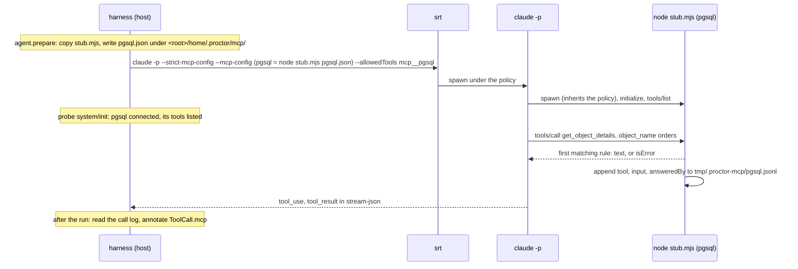

# Conception : stubs MCP

| | |
|---|---|
| Statut | proposition, non implémentée ; à valider avant tout code |
| Date | 2026-11-10 |
| Périmètre | la capacité **tools** des serveurs MCP, transport stdio, adaptateur `claude-code` d'abord |
| Vérifié sur | Claude Code 2.1.286, `@anthropic-ai/sandbox-runtime` 0.0.78, macOS |

Les exemples d'écriture ci-dessous sont balisés `typescript`, pas `ts` : `test/docs.test.ts` compile chaque bloc `ts` qui importe `@fluce/proctor`, et cette API n'existe pas encore. Les pull requests d'implémentation les transforment en blocs `ts` des pages de référence.

## Problème

Un skill fonde souvent sa réponse sur un serveur MCP : une base de données, un outil de tickets, un backend d'observabilité. Dans une évaluation, l'espace de travail contient un diff ou un dépôt, et ce serveur n'existe pas. Chaque étape du skill qui lit le serveur n'est jamais mesurée.

Exemple : un skill de revue SQL doit appeler `get_object_details` sur un serveur MCP `pgsql` avant de signaler un index manquant sur `orders`, et lire la taille de la table avant de qualifier un verrou de bloquant. Aujourd'hui, une évaluation de ce skill ne mesure que ce que le modèle devine à partir du diff.

L'auteur de la suite veut déclarer, par cas, ce que le serveur aurait répondu (« `orders` contient 180M de lignes, l'index sur `customer_id` existe »), et mesurer que l'agent appelle les bons outils et utilise leurs réponses.

## Objectifs et non-objectifs

| Objectif | Non-objectif |
|---|---|
| Déclarer un faux serveur MCP, ses outils et ses réponses préparées dans un `*.eval.ts` | resources, prompts, sampling, elicitation, notifications |
| Réponses par cas, présence par variante (ablation : avec et sans le serveur) | les transports HTTP et SSE |
| Rester dans la sandbox de l'essai : pas de réseau, pas de fichier de l'hôte | enregistrement et rejeu d'un vrai serveur (voir [travaux futurs](#travaux-futurs)) |
| Évaluer les appels : quel outil, avec quelle entrée, combien de fois | simuler la latence, les timeouts, les plantages du serveur |
| Gratuit en dry run (`--agent fake`), aucun coût de modèle pour le stub | valider les entrées des outils par rapport à `inputSchema` |

## Ce qui existe aujourd'hui

Faits lus dans le code sur `origin/main` (`07a4a55`).

| Fait | Où |
|---|---|
| Une variante porte déjà des serveurs MCP bruts, `Record<string, unknown>`, opaques pour le cœur | `src/core/model.ts:33`, `src/dsl/variant.ts:52-54` |
| Ils parviennent à l'adaptateur sous la forme `AgentRunInput.mcpServers` | `src/ports/agent.ts:17-18`, `src/core/lifecycle.ts:130-134` |
| L'adaptateur passe toujours `--strict-mcp-config --mcp-config '<inline JSON>'` | `src/adapters/agents/claude-code/flags.ts:38-40` |
| Les permissions `readonly` valent `--permission-mode dontAsk --tools Read` | `src/adapters/agents/claude-code/flags.ts:16` |
| La sonde d'isolation interrompt l'exécution quand `system/init` liste un serveur MCP ou un outil `mcp__*` non déclaré ; déclaré signifie une clé de `mcpServers` | `src/adapters/agents/claude-code/init-probe.ts:35-44`, `adapter.ts:119` |
| Les noms d'outils sont `mcp__<server>__<tool>`, le nom du serveur étant normalisé en `[A-Za-z0-9_-]` | `src/adapters/agents/claude-code/init-probe.ts:24` |
| Sous srt, les serveurs MCP lancés par `claude` héritent de la politique : home et répertoire temporaire de l'hôte masqués, seuls `work/`, `home/`, `tmp/` de l'essai et le répertoire du binaire de l'agent sont lisibles | `src/adapters/sandboxes/srt/sandbox.ts:34-37`, `srt/config.ts:44-54`, `adapter.ts:70` |
| Le `PATH` de l'agent retire toute entrée sous le home de l'hôte | `src/adapters/sandboxes/temp-layout.ts:62-66` |
| Les blocs `tool_use` et `tool_result` deviennent `ToolCall { name, input, output, isError }` | `src/adapters/agents/claude-code/stream-parser.ts:148-158` |
| `toolUsed` compare un nom d'outil et une regex sur le JSON de l'entrée | `src/graders/tool-calls.ts:24-26`, `src/graders/tool-used.ts:19-31` |
| Le juge voit la réponse finale et le diff, jamais les appels d'outils | `src/graders/llm-judge.ts:173` |
| `--agent fake` avec une vraie sandbox lance une commande shell via `workspace.wrap` | `src/cli/registry.ts:36-41`, `src/adapters/sandboxes/probe.ts` |

## Résultats du spike

Un serveur stdio sans dépendance (une quarantaine de lignes de Node) et un faux local de l'API Messages (`ANTHROPIC_BASE_URL=http://127.0.0.1:<port>`, fausse clé) ont piloté le vrai binaire `claude` sur un appel d'outil complet. Aucune requête n'a quitté la machine : aucun modèle n'a été facturé.

| Question | Observé |
|---|---|
| Un serveur stdio inline passé par `--mcp-config` se charge-t-il sous `--strict-mcp-config` ? | oui : `system/init` liste `{"name":"pgsql","status":"connected","source":"dynamic"}` et l'outil `mcp__pgsql__get_object_details` |
| Poignée de main (handshake) à laquelle le serveur doit répondre | `initialize`, puis la notification `notifications/initialized`, puis `tools/list`, puis `tools/call` ; rien d'autre n'a été envoyé |
| `--tools Read` masque-t-il les outils MCP ? | non : la requête porte `Read` et l'outil MCP |
| `readonly` peut-il appeler le stub ? | non : `dontAsk` le refuse (`Permission to use mcp__pgsql__get_object_details has been denied because Claude Code is running in don't ask mode`) |
| Qu'est-ce qui l'autorise ? | soit `--allowedTools mcp__pgsql`, soit `--settings '{"permissions":{"allow":["mcp__pgsql__get_object_details"]}}'` ; les deux sont vérifiés |
| Qu'est-ce qui atteint le flux ? | `tool_use` avec l'entrée, `tool_result` avec le texte ; `isError: true` côté serveur devient `"is_error": true` |
| Cela fonctionne-t-il sous la politique srt d'un essai ? | oui : node depuis `/usr/local/bin`, le stub et sa configuration copiés sous `<root>/home/.proctor/mcp/`, home et répertoire temporaire de l'hôte masqués ; `connected`, outil appelé, réponse reçue |
| Un plugin dont le `.mcp.json` déclare un serveur, sous `--strict-mcp-config` | le plugin se charge, son serveur **ne démarre jamais**, quel que soit son nom (`pgsql` ou `other`) |
| Le même plugin sans `--strict-mcp-config` | son serveur s'appelle `plugin:<plugin>:<server>` (`"source":"plugin"`), ses outils `mcp__plugin_<plugin>_<server>__<tool>` |
| Un stub peut-il prendre le nom du serveur d'un plugin ? | oui : un serveur `--mcp-config` nommé `plugin:dbtools:pgsql` expose `mcp__plugin_dbtools_pgsql__get_object_details`, et `--allowedTools mcp__plugin_dbtools_pgsql` l'autorise |
| 15 outils aux descriptions longues | tous envoyés directement au modèle, aucun différé derrière une recherche d'outils |

Conséquence : proctor écarte déjà les serveurs MCP de tous les plugins qu'il charge. Un stub ne peut pas entrer en collision avec l'un d'eux ; il le remplace par construction, et prend son nom quand le skill nomme ses outils en entier.

## Mécanique



| Point | Proposition | Pourquoi |
|---|---|---|
| Transport | stdio, un processus par serveur stub et par essai, lancé par `claude` | lancé par l'agent, il hérite de la politique srt : pas de réseau, pas de port, rien à ouvrir dans la sandbox |
| Programme du stub | un module ES autonome, `src/adapters/mcp-stub/stub-server.mjs`, uniquement les modules natifs de Node, `// @ts-check` avec des types JSDoc | Node 22.12 ne sait pas exécuter du `.ts` sans option ; pas de `node_modules` à rendre lisible dans la sandbox |
| Où il se trouve pendant un essai | copié par `prepare` dans `<root>/home/.proctor/mcp/stub.mjs` | le paquet est souvent sous le home masqué de l'hôte ; le home de l'essai est lisible |
| Binaire Node | `process.execPath`, le node qui exécute proctor (>= 22.12), par chemin absolu | le `PATH` de la sandbox retire les entrées sous le home de l'hôte (nvm, fnm, volta) |
| Accès sandbox | l'adaptateur ajoute `dirname(process.execPath)` à ses `sandboxAccess.readablePaths`, comme pour le binaire `claude` | un node installé sous le home de l'hôte serait sinon masqué |
| Configuration | un fichier JSON par serveur, `<root>/home/.proctor/mcp/<server>.json`, écrit par `prepare` (hors de la sandbox) | des données, pas du code : voir [sérialisabilité](#sérialisabilité) ; un fichier garde petit l'argument de `--mcp-config` (un argument est limité à 128 KiB sous Linux, `flags.ts:22-24`) |
| `--mcp-config` | les `mcpServers` de la variante plus une entrée par stub : `{ type: "stdio", command: <node>, args: [<stub.mjs>, <server>.json, <call log>] }` | le flag existe déjà et reste strict |
| Permissions | `--allowedTools mcp__<normalized server>` par stub, quel que soit le niveau de permission | un stub n'a aucun effet de bord : `readonly` doit pouvoir l'appeler, sinon `dontAsk` refuse chaque appel |
| Sonde d'isolation | les stubs comptent comme des serveurs déclarés ; un stub non `connected` dans `system/init`, ou un outil déclaré absent de `tools`, arrête l'exécution (`other`) avec la cause | un stub qui n'a pas démarré mesurerait silencieusement le skill sans le serveur |
| Journal d'appels | le stub ajoute `{ tool, input, answeredBy, rule }` à `<root>/tmp/.proctor-mcp/<server>.jsonl` ; l'adaptateur le lit après l'exécution et annote les appels d'outils correspondants | distingue un appel anticipé par le cas d'un appel servi par la réponse de repli, sans analyser le texte de la réponse |
| Noms d'outils vus par Claude | `mcp__<server>__<tool>` ; `mcp__plugin_<plugin>_<server>__<tool>` pour un stub qui prend le nom du serveur d'un plugin | convention de Claude Code, vérifiée |
| Un plugin qui déclare le même serveur | rien à faire : `--strict-mcp-config` ne le démarre jamais (vérifié) ; `mcpStub("pgsql").ofPlugin("dbtools")` nomme le stub `plugin:dbtools:pgsql` quand le skill nomme ses outils en entier | le stub remplace le serveur du plugin avec les mêmes noms d'outils |

Le stub répond à `initialize` (capacités `{ tools: {} }`, en renvoyant la version de protocole du client), `ping`, `tools/list` et `tools/call`, ignore les notifications, et répond `-32601` à toute autre méthode. `tools/call` sur un outil non déclaré renvoie un résultat `isError` : Claude n'appelle que les outils listés, donc cela ne protège que d'une configuration périmée.

### Qui fait quoi

| Couche | Changement |
|---|---|
| `core/model.ts` | `McpStubDefinition` (serveur, outils, règles, repli) comme données simples sérialisables, sur `VariantDefinition.mcpStubs` ; règles de cas sur `CaseDefinition.mcpStubRules` ; schémas zod et contrôles croisés dans `suiteSchema` |
| `core/` | une fonction pure `stubsFor(variant, testCase)` qui fusionne les règles du cas dans les stubs de la variante, appelée par `agentSetup` (`lifecycle.ts:130`) |
| `ports/agent.ts` | `AgentRunInput.mcpStubs: readonly McpStubDefinition[]` ; `ToolCall.mcp?: { server, tool, answeredBy }` |
| `dsl/` | builder `mcpStub()`, `VariantBuilder.mcpStub()`, `CaseBuilder.mcpStub()` |
| `adapters/mcp-stub/` | `stub-server.mjs` (protocole et correspondance), `materialize.ts` (copie le script, écrit les configurations, renvoie les entrées `--mcp-config`, lit les journaux d'appels) ; partagé par tous les adaptateurs |
| `adapters/agents/claude-code/` | `prepare` matérialise, `flags.ts` ajoute les entrées et `--allowedTools`, `init-probe.ts` vérifie `connected` et les outils, `run` annote `ToolCall.mcp` |
| `graders/`, `ports/grader.ts` | `mcpCalled()` ; `GradeContext.mcpStubs`, les noms des stubs de l'essai |
| `testing/`, `cli/registry.ts` | l'agent fake fait le handshake avec chaque stub à travers la sandbox ; `answerStub()` pour les tests |
| `reporters/` | compteurs par essai dans le CTRF, un avertissement quand le repli a répondu |

MCP est un protocole, pas un agent : le cœur et les ports portent les stubs comme des données neutres vis-à-vis de l'agent, comme ils portent déjà `mcpServers`. Ajouter OpenCode revient à ajouter un adaptateur qui écrit sa propre configuration MCP à partir des mêmes entrées matérialisées : aucun diff dans `core/` ni `ports/`.

## API d'écriture

### La forme complète

```typescript
import { mcpCalled, mcpError, mcpStub, suite } from "@fluce/proctor"

// The server as the agent sees it: tools, descriptions, input schemas, and answers shared by every case.
const pgsql = mcpStub("pgsql")
  .tool("list_instances", (t) =>
    t.description("Lists the PostgreSQL instances you can query.").inputSchema({ type: "object", properties: {} }).returns({ instances: ["prod"] }),
  )
  .tool("get_object_details", (t) =>
    t.description("Columns, nullability, constraints and indexes of a table.").inputSchema({
      type: "object",
      properties: { instance: { type: "string" }, schema: { type: "string" }, object_name: { type: "string" } },
      required: ["instance", "object_name"],
    }),
  )
  .otherwise(mcpError("relation does not exist"))

const ORDERS_WITH_INDEX = { table: "public.orders", indexes: ["orders_pkey (id)", "orders_customer_id_idx (customer_id)"] }

export default suite("sql-review")
  .variant("with-pgsql", (v) => v.mcpStub(pgsql).prompt((c) => `Review change.diff as a DBA.\n\n${c.context}`))
  .case("index-exists", (c) =>
    c
      .mcpStub(pgsql, (s) => s.on("get_object_details", { object_name: "orders" }).returns(ORDERS_WITH_INDEX))
      .expect(mcpCalled("reads-orders", pgsql, { tool: "get_object_details", input: { object_name: "orders" } })),
  )
```

| Builder | Méthodes | Renvoie |
|---|---|---|
| `mcpStub(name)` | `.tool(name, t => …)`, `.otherwise(response)`, `.ofPlugin(plugin)` | `McpStub<Tools>`, immuable ; `Tools` est l'union des noms d'outils déclarés |
| outil `t` | `.description(text)`, `.inputSchema(jsonSchema)`, `.returns(r)`, `.fails(text)`, `.on(when).returns(r)` / `.fails(text)` / `.returnsInOrder(...r)`, `.otherwise(response)` | builder d'outil |
| variante `v` | `.mcpStub(stub)`, répétable | `VariantBuilder` |
| cas `c` | `.mcpStub(stub, s => s.on(tool, when?).returns(r) …)`, répétable | `CaseBuilder` |
| règles de cas `s` | `.on(tool: Tools, when?)` puis `.returns(r)`, `.fails(text)` ou `.returnsInOrder(...r)` | `McpStubRules<Tools>` ; un `.on()` sans réponse ne compile pas |
| helpers | `mcpError(text)` : une réponse `isError`, utilisable dans `.returns`, `.returnsInOrder`, `.otherwise` | `McpStubResponse` |
| évaluateur | `mcpCalled(id, stub, { tool?, input?, answeredBy? }, { min?, max? })`, sur le modèle de `toolUsed(id, match, count)` | `Grader` |

`.returns(r)` sur un outil est un raccourci pour `.on().returns(r)` : une réponse à n'importe quelle entrée.

### Niveaux et règles de fusion

| Quoi | Niveau | Règle |
|---|---|---|
| Le serveur existe dans l'essai | variante : `v.mcpStub(pgsql)` | une variante sans lui s'exécute sans le serveur : deux variantes mesurent le skill avec et sans lui |
| Outils, descriptions, schémas d'entrée | la valeur `mcpStub()` | un seul catalogue, partagé ; le cas ne peut pas ajouter d'outil |
| Réponses partagées par tous les cas | la valeur `mcpStub()` : `t.returns(...)`, `t.on(...)` | par exemple `list_instances` répond toujours `prod` |
| Réponses d'un cas | cas : `c.mcpStub(pgsql, s => …)` | ne s'appliquent que dans les variantes qui déclarent `pgsql` ; ignorées dans les autres |
| Repli | `t.otherwise(...)`, sinon `mcpStub().otherwise(...)`, sinon intégré | intégré : `isError`, texte `No result for these arguments.` |

Résolution d'un appel `(server, tool, input)`, la première correspondance l'emporte :

1. les règles du cas pour cet outil, dans l'ordre de déclaration ;
2. les règles de la valeur `mcpStub()` pour cet outil, dans l'ordre de déclaration ;
3. le `otherwise` de l'outil, puis celui du serveur, puis le repli intégré.

Contrôles à `toDefinition()`, chacun avec un message qui dit quoi faire :

| Problème | Message |
|---|---|
| un cas répond pour un serveur qu'aucune variante ne déclare | `case "x" > mcpStub "pgsql": no variant declares this MCP stub; add .mcpStub(pgsql) to a variant` |
| un cas répond pour un outil que le stub de ce nom dans la variante n'a pas (deux valeurs `mcpStub("pgsql")` différentes) | `case "x" × variant "y" > mcpStub "pgsql": no tool "explain_query"` |
| un stub et une entrée brute de `.mcpServers()` partagent un nom, ou deux stubs se normalisent vers le même préfixe d'outil | `variant "y": "pgsql" is declared twice; rename one` |
| un matcher contient une fonction, une instance de classe, `undefined` ou une valeur non JSON | `case "x" > mcpStub "pgsql" > get_object_details > rule 1: predicates cannot cross to the stub process; use an object pattern or a RegExp` |
| un nom de serveur ou d'outil hors de `[A-Za-z0-9_-]` (`:` autorisé uniquement via `.ofPlugin`) | les caractères autorisés |

### Faire correspondre une entrée

| `when` | Correspond à | Exemple |
|---|---|---|
| omis | n'importe quelle entrée | `.on("list_instances")` |
| motif objet | chaque clé du motif est dans l'entrée et correspond, récursivement ; les clés d'entrée en trop sont ignorées | `{ object_name: "orders" }` |
| `RegExp` comme valeur | un champ chaîne qu'elle reconnaît (`search`) | `{ object_name: /^(public\.)?orders$/i }` |
| tableau comme valeur | même longueur, élément par élément | `{ columns: ["customer_id"] }` |
| `RegExp` comme `when` | le JSON de l'entrée entière, comme le fait `toolUsed` | `.on("execute_sql", /reltuples/)` |

Le même type de motif sert pour l'`input` de `mcpCalled` : ce qu'un cas répond et ce qu'il attend se lisent de la même façon.

### Réponses

| Appel | L'agent reçoit |
|---|---|
| `.returns("text")` | `content: [{ type: "text", text }]` |
| `.returns({ … })` ou un tableau, un nombre, un booléen | la valeur sous forme de texte JSON indenté, ce que renvoient la plupart des serveurs |
| `.fails("text")`, `.returns(mcpError("text"))` | le même texte avec `isError: true` |
| `.returnsInOrder(a, b, mcpError("c"))` | `a` au premier appel correspondant, `b` au deuxième, puis `c` à chaque appel suivant |

Une réponse volumineuse, un plan `EXPLAIN` par exemple, est lue par la suite elle-même : `.returns(await readFile(new URL("./plan.txt", import.meta.url), "utf8"))`.

### Sérialisabilité

Le stub s'exécute dans un autre processus, à l'intérieur de la sandbox : une closure ne peut pas le traverser. La proposition garde chaque règle déclarative.

| Option | Pour | Contre | Décision |
|---|---|---|---|
| Matchers déclaratifs (motif objet, `RegExp`) et réponses statiques | JSON plus `{ "$regex": source, "flags": flags }` ; validé au chargement ; déterministe ; le même matcher évalue | pas de réponse calculée | **v1** |
| Un module handler chargé par le stub (`.handledBy(new URL("./handler.mjs", import.meta.url))`) | toute logique, par exemple un faux moteur SQL | le module et ses imports doivent être lisibles dans la sandbox ; l'agent peut le lire ; plus difficile à garder déterministe | plus tard, si une suite en a besoin : un module ES d'un seul fichier, sans import, copié dans l'essai |
| Le stub rappelle le harnais (socket, HTTP) pour exécuter un prédicat JS | closures complètes | ouvre un canal hors de la sandbox, exactement ce que srt ferme | rejeté |

Les types refusent les fonctions (`JsonPattern` n'a aucun membre fonction) et zod les refuse au chargement pour les suites écrites en JS.

### Schémas d'entrée

| Option | Pour | Contre | Décision |
|---|---|---|---|
| Objet JSON Schema | ce que MCP envoie sur le réseau ; à copier tel quel depuis le `tools/list` du vrai serveur | non typé en TS | **v1** ; omis, il vaut `{ "type": "object" }` |
| Schéma zod, converti avec `z.toJSONSchema` (zod 4 est déjà une dépendance) | motifs `when` typés | une seconde voie ; une conversion qui peut différer du vrai serveur | plus tard |

Le stub ne valide pas les entrées par rapport au schéma : Claude les construit déjà à partir de celui-ci, et un validateur serait une dépendance. La fidélité compte davantage : le modèle choisit les outils d'après leurs descriptions et leurs schémas, donc copiez-les depuis le vrai serveur.

## Évaluateurs et juge

| Besoin | Aujourd'hui, sans nouveau code | Proposé |
|---|---|---|
| L'agent a appelé un outil | `toolUsed("reads-orders", { tool: "mcp__pgsql__get_object_details" })` | `mcpCalled("reads-orders", pgsql, { tool: "get_object_details" })` |
| … avec une entrée donnée | `input: /"object_name":"(public\.)?orders"/` sur le JSON | `input: { object_name: /^(public\.)?orders$/ }`, le matcher du stub |
| … un certain nombre de fois | `toolUsed(…, { min, max })` | `mcpCalled(…, { min, max })`, même `CallCount` |
| L'agent n'a jamais demandé ce que le cas n'avait pas anticipé | impossible : le texte de repli est tout ce qu'il y a | `mcpCalled("all-anticipated", pgsql, { answeredBy: "fallback" }, { min: 0, max: 0 })` |

- `mcpCalled` lit `ToolCall.mcp`, que l'adaptateur remplit depuis le journal d'appels : il ne connaît pas la nomenclature `mcp__…`, donc il reste neutre vis-à-vis de l'agent, et le nom de l'outil est typé à partir de la valeur du stub.
- Dans un essai dont la variante n'a aucun stub de ce nom, `mcpCalled` est sans objet : `passed: true, criteria: []`, la règle des [frontières](https://github.com/Luce-Florian/proctor/blob/main/CLAUDE.md#boundaries). Il lit les stubs de l'essai dans un nouveau `GradeContext.mcpStubs` (les noms seulement). Une variante sans le serveur est alors mesurée par les critères du juge, et non échouée par construction.
- `toolUsed` continue de fonctionner sur `mcp__pgsql__…`, comme il fonctionne sur `Read` ou `Bash` : une suite peut démarrer sans `mcpCalled`.
- Le juge ne voit que la réponse finale et le diff (`llm-judge.ts:173`). L'auteur du cas sait ce que répond le stub : les critères énoncent ces faits (« `get_object_details` signale un index sur `orders(customer_id)` ; la réponse n'en demande pas »). Le juge vérifie alors la réponse par rapport au critère, et non par rapport à une sortie d'outil que l'agent aurait pu orienter.

## Dry run, agent fake, rapports, coût

| Sujet | Proposition |
|---|---|
| `--agent fake --sandbox srt` | après `probeSandbox`, l'agent fake matérialise les stubs et lance, via `workspace.wrap`, un handshake `initialize` + `tools/list` avec chacun : node lisible, configuration valide, outils listés, gratuitement. Un échec termine l'essai en `other` avec `The MCP stub "pgsql" did not start in the sandbox: …` |
| `--agent fake` seul (sandbox fake) | les configurations sont validées dans le processus, rien n'est lancé |
| `proctor list` | affiche les stubs de chaque variante, par exemple `with-pgsql  mcp stubs: pgsql (2 tools)` |
| Tests | `@fluce/proctor/testing` exporte `answerStub(input.mcpStubs, "pgsql", "get_object_details", input)` : une réponse de `FakeAgentAdapter` renvoie le `ToolCall` que le stub aurait produit, avec son annotation `mcp`, de sorte que les évaluateurs se testent sans `claude` |
| CTRF | par test, `extra.mcpStubCalls` (appels auxquels un stub a répondu) et `extra.mcpStubFallbacks` (appels auxquels un repli a répondu) ; ni entrée ni sortie : un verdict et un rapport ne contiennent jamais de données d'outil |
| Résumé, HTML, console | une note sur chaque essai dont `mcpStubFallbacks > 0` : l'agent a demandé quelque chose que le cas n'avait pas anticipé ; le cas a peut-être besoin d'une règle |
| Transcriptions | inchangées : le flux contient déjà chaque `tool_use` et `tool_result` |
| Coût | le stub est un processus Node local, aucun modèle ; l'agent paie les tokens des définitions d'outils et des réponses, comme avec un vrai serveur |

## Exemple de bout en bout

Un skill de revue SQL, deux cas sur le même type de changement : un index qui existe et un qui n'existe pas. Même forme de diff, réponses du serveur différentes, verdict attendu différent : la paire mesure que le skill lit le serveur au lieu de deviner.

```typescript
// evals/sql-review.eval.ts
import { fileURLToPath } from "node:url"
import { type CaseBuilder, directory, judge, limits, mcpCalled, mcpError, mcpStub, suite } from "@fluce/proctor"

const PLUGIN = fileURLToPath(new URL("../plugins/sql-review", import.meta.url))
const JUDGE_MODEL = "claude-sonnet-5"
const INSTANCE = { type: "string", description: "Instance name, from list_instances." }

/** The server as the skill expects it; descriptions and schemas copied from the real server's tools/list. */
const pgsql = mcpStub("pgsql")
  .tool("list_instances", (t) =>
    t
      .description("Lists the PostgreSQL instances you are granted.")
      .inputSchema({ type: "object", properties: {} })
      .returns({ instances: [{ name: "prod", version: "16.4" }] }),
  )
  .tool("get_object_details", (t) =>
    t
      .description("Columns, nullability, constraints and indexes of a table or a view.")
      .inputSchema({
        type: "object",
        properties: { instance: INSTANCE, schema: { type: "string" }, object_name: { type: "string" } },
        required: ["instance", "object_name"],
      })
      .otherwise(mcpError("relation does not exist")),
  )
  .tool("execute_sql", (t) =>
    t
      .description("Runs a read-only SQL statement. Statements are cut at 30 s.")
      .inputSchema({ type: "object", properties: { instance: INSTANCE, sql: { type: "string" } }, required: ["instance", "sql"] })
      .otherwise(mcpError("permission denied: only catalog queries are allowed on this instance")),
  )

const ORDERS_COLUMNS = [
  { name: "id", type: "bigint", nullable: false },
  { name: "customer_id", type: "bigint", nullable: false },
  { name: "created_at", type: "timestamptz", nullable: false },
]

/** What the two cases share: a workspace holding change.diff, the context, the call of get_object_details on orders, a budget. */
const reviewCase = (dir: string) => (c: CaseBuilder<"without-expectation">) =>
  c
    .fixture(directory(new URL(dir, import.meta.url)))
    .context("change.diff adds a query on orders filtered by customer_id.")
    .expect(mcpCalled("reads-orders", pgsql, { tool: "get_object_details", input: { object_name: /^(public\.)?orders$/ } }))
    .expect(mcpCalled("all-anticipated", pgsql, { answeredBy: "fallback" }, { min: 0, max: 0 }))
    .expect(limits().maxCostUsd(2))

const PROMPT = (c: { context: string }) => `/sql-review:review change.diff\n\n${c.context}`

export default suite("sql-review")
  .variant("with-skill", (v) => v.plugins(PLUGIN).mcpStub(pgsql).prompt(PROMPT))
  .variant("with-skill-no-server", (v) => v.plugins(PLUGIN).prompt(PROMPT))
  .case("orders-by-customer-index-exists", (c) =>
    reviewCase("./cases/index-exists/")(c)
      .mcpStub(pgsql, (s) =>
        s
          .on("get_object_details", { object_name: /^(public\.)?orders$/ })
          .returns({
            table: "public.orders",
            columns: ORDERS_COLUMNS,
            indexes: [
              { name: "orders_pkey", definition: "PRIMARY KEY (id)" },
              { name: "orders_customer_id_idx", definition: "btree (customer_id)" },
            ],
          })
          .on("execute_sql", /reltuples/)
          .returns([{ relation: "public.orders", estimated_rows: 180_000_000, total_size: "48 GB" }]),
      )
      .expect(
        judge()
          .model(JUDGE_MODEL)
          .criterion("approves", "Approves the query: no blocker", { principal: true })
          .decoy(
            "decoy-asks-existing-index",
            "Asks for an index on orders(customer_id), which get_object_details reports as orders_customer_id_idx",
          ),
      ),
  )
  .case("orders-by-customer-index-missing", (c) =>
    reviewCase("./cases/index-missing/")(c)
      .mcpStub(pgsql, (s) =>
        s
          .on("get_object_details", { object_name: /^(public\.)?orders$/ })
          .returns({ table: "public.orders", columns: ORDERS_COLUMNS, indexes: [{ name: "orders_pkey", definition: "PRIMARY KEY (id)" }] })
          .on("execute_sql", /reltuples/)
          .returns([{ relation: "public.orders", estimated_rows: 180_000_000, total_size: "48 GB" }]),
      )
      .expect(mcpCalled("reads-size", pgsql, { tool: "execute_sql", input: /reltuples|pg_total_relation_size/ }))
      .expect(
        judge()
          .model(JUDGE_MODEL)
          .criterion(
            "index-concurrently",
            "Asks for CREATE INDEX CONCURRENTLY on orders(customer_id), backed by the size the server reports (about 180M rows)",
            { principal: true },
          )
          .decoy("decoy-invented-size", "States a table size other than the one the server reports"),
      ),
  )
```

Ce que mesure chaque élément :

| Évaluateur | Dans `with-skill` | Dans `with-skill-no-server` |
|---|---|---|
| `reads-orders`, `reads-size` | le skill a lu la table avant de conclure sur ses index et sa taille | sans objet : pas de stub `pgsql` dans l'essai ([question ouverte 2](#questions-ouvertes)) |
| `all-anticipated` | les cas répondent à tout ce que le skill a demandé ; un échec pointe une règle manquante, pas le skill | sans objet |
| `approves` + `decoy-asks-existing-index` | le skill a utilisé la réponse, et non le réflexe « ajouter un index sur la clé étrangère » | le skill devine : le leurre mesure la fréquence à laquelle il demande un index qui existe |
| `index-concurrently` + `decoy-invented-size` | le bloquant s'appuie sur la taille signalée | le skill n'a pas de taille : un critère principal qu'il ne peut satisfaire que par un verdict conditionnel |

Les critères du juge énoncent ce que répond le stub, donc le juge n'a besoin d'aucune sortie d'outil. L'écart entre les deux variantes est la valeur du serveur pour le skill.

## Options étudiées

### Où le serveur est déclaré

| Option | Pour | Contre |
|---|---|---|
| Cas seulement : `c.mcpStub(...)` rend le serveur présent dans toutes les variantes, `v.withoutMcpStub("pgsql")` s'en désinscrit | un seul endroit | l'ablation est une exception à écrire ; une variante ne dit plus ce que possède l'agent |
| Suite : `suite().mcpStub(pgsql)` | une ligne pour toutes les variantes | un troisième niveau ; même problème de désinscription |
| **La variante déclare la présence, la valeur du stub porte le catalogue, le cas porte ses réponses** | cohérent avec `.plugins()` et `.mcpServers()` : la variante est ce qui change entre deux mesures (`model.ts:28`) ; l'ablation est une variante ; les réponses restent avec le cas qu'elles fondent | deux appels à écrire |

Recommandé : la troisième. Une suite dont toutes les variantes ont le serveur ajoute `.mcpStub(pgsql)` dans le helper qui les construit.

### Comment le stub est atteint

| Option | Pour | Contre |
|---|---|---|
| **stdio, lancé par `claude`** | dans la sandbox par héritage, pas de réseau, vérifié | le stub et l'agent partagent la sandbox : l'agent peut lire la configuration |
| HTTP sur loopback, servi par le harnais hors de la sandbox | configuration illisible par l'agent ; closures possibles | ouvre le loopback à travers srt (`allowLocalBinding` ou une IP littérale dans `allowedDomains`) ; un port par essai ; un serveur à arrêter |
| La CLI proctor comme stub (`node bin/proctor.js mcp-stub`) | aucun fichier supplémentaire | `tsx` et `node_modules` doivent être lisibles dans la sandbox, souvent sous le home masqué |

Recommandé : stdio avec un `.mjs` autonome.

### Évaluateurs

| Option | Pour | Contre |
|---|---|---|
| `toolUsed` sur `mcp__pgsql__…` seulement | rien à construire | noms propres à l'agent dans chaque suite ; regex sur du JSON ; aucun signal d'« appel non anticipé » |
| **`mcpCalled` sur `ToolCall.mcp`, `toolUsed` toujours utilisable** | neutre vis-à-vis de l'agent, noms d'outils typés, même matcher que le stub, `answeredBy` | un évaluateur et un champ de port à ajouter |

## Hors périmètre, risques, limites

| Élément | Statut |
|---|---|
| Resources, prompts, sampling, elicitation, notifications `listChanged` | hors périmètre : le stub déclare `capabilities: { tools: {} }` seulement |
| Transports HTTP et SSE | hors périmètre ; le stub est stdio |
| Un vrai serveur MCP dans une évaluation | déjà possible avec `.mcpServers({...})` ; un serveur qui a besoin du réseau ou d'un identifiant exige `.allowDomains()` et un secret, hors périmètre comme aujourd'hui |
| L'agent lit les réponses préparées | la configuration se trouve dans le home de l'essai, lisible par l'agent sous toute sandbox. Atténuation : un chemin et des noms de fichiers neutres ; l'adaptateur signale dans le rapport tout appel d'outil dont l'entrée mentionne `.proctor/mcp` |
| L'agent altère le journal d'appels | il se trouve dans le `tmp` de l'essai, accessible en écriture. Risque faible ; le flux reste la source de vérité de ce qui a été appelé |
| Conscience de l'évaluation | rien dans ce que voit l'agent ne dit « stub » : texte de repli intégré neutre, `serverInfo` nommé d'après le serveur |
| Serveurs MCP de plugins | `--strict-mcp-config` les écarte aujourd'hui (vérifié), silencieusement : mérite une ligne dans les [Limites connues](../../limitations.md), indépendamment de cette conception |
| Recherche d'outils | un grand catalogue peut être différé par Claude Code derrière une recherche d'outils ; 15 outils ne l'ont pas été. À vérifier avec le catalogue réel d'une suite |
| Comportement selon les versions de Claude Code | la sonde fige déjà ce que `system/init` doit montrer ; un champ renommé fait échouer l'essai en `other`, pas silencieusement |
| Fidélité des réponses | une réponse inventée par l'auteur peut être plus facile que celle du vrai serveur ; la consigne est de copier de vraies sorties (anonymisées) |
| Windows | comme srt : WSL2 uniquement |

### Travaux futurs

- **Enregistrement et rejeu.** `proctor mcp record --server pgsql -- <real server command>` exécute une session contre le vrai serveur, sauvegarde `tools/list` et chaque `tools/call` avec sa réponse, et écrit un module `mcpStub()` que l'auteur anonymise. Il garde les descriptions et les schémas fidèles, et fournit de vraies réponses. Il nécessite des identifiants et le réseau, donc il s'exécute hors de tout essai, à la main.
- Un module handler pour les réponses calculées (voir [sérialisabilité](#sérialisabilité)).
- `judge().toolResults(match)` : donner au juge les réponses du stub comme données non fiables, si les critères qui les reformulent s'avèrent trop lourds.
- `when` typé à partir d'un schéma d'entrée zod.

## Plan d'implémentation

Chaque étape est une pull request, verte sur `npm run check`, avec sa documentation dans `docs/` et `docs/fr/`. Pré-1.0 et `bump-minor-pre-major`, donc chaque `feat` incrémente la version mineure : release-please les regroupe, et le mainteneur publie une fois l'étape 3 fusionnée, par exemple `0.3.0`.

| # | Pull request | Contenu | Tests |
|---|---|---|---|
| 1 | `feat(dsl): declare MCP stubs` | `mcpStub()`, `mcpError()`, méthodes de variante et de cas, types du modèle, schémas zod et contrôles croisés, fusion `stubsFor()`, `AgentRunInput.mcpStubs` ; l'adaptateur refuse les stubs avec une erreur claire jusqu'à l'étape 3 | specs : immuabilité des builders, restriction des types (`test/support/typecheck`), chaque message de validation, ordre de fusion ; behavior : `runSuite` avec `FakeAgentAdapter` reçoit les stubs fusionnés |
| 2 | `feat(mcp-stub): stdio stub server` | `stub-server.mjs`, `materialize.ts`, journal d'appels | specs qui lancent `node stub-server.mjs` (stdio uniquement, aucun socket, autorisé par `test/support/setup.ts`) : handshake, `tools/list`, ordre des règles, motifs, séquences, replis, méthode inconnue, journal d'appels ; `srt.integration.test.ts` gagne un cas : le stub répond à un handshake sous la vraie politique srt |
| 3 | `feat(claude-code): run MCP stubs` | `prepare`, flags (entrées `--mcp-config`, `--allowedTools`), node lisible, sonde (`connected`, outils), `ToolCall.mcp` depuis le journal d'appels | specs : sortie de `claudeArgs`, cas de la sonde (stub en échec, outil manquant, stub nommé d'après un plugin) ; une fixture `stream-json` enregistrée et anonymisée avec un `tool_use` / `tool_result` MCP, rejouée par `fake-claude.sh` dans un test de comportement |
| 4 | `feat(graders): mcpCalled` et rapports | `mcpCalled`, `answerStub` dans `testing/`, handshake de l'agent fake, champs CTRF, notes dans le résumé et le HTML | specs de l'évaluateur ; behavior : dry run CLI `--agent fake` sur une suite d'exemple avec un stub ; test du schéma CTRF |
| 5 | `docs: MCP stubs` | `docs/writing-evals/mcp-stubs.md` et sa page française, sidebar, `graders.md`, `agents/claude-code/index.md` (table des flags), `sandboxes.md` (node lisible), `limitations.md` ; un `examples/mcp-stub.eval.ts` couvert par les tests de la CLI ; cette page de conception supprimée ou marquée comme implémentée | `test/docs.test.ts` compile les nouveaux blocs `ts` |
| 6 | campagne manuelle | une vraie exécution d'une petite suite avec un stub, rédigée dans `docs/campaigns/<date>-mcp-stub.md` comme les campagnes précédentes | hors de `npm test` : elle appelle un modèle |

Une vérification de bout en bout à coût nul, comme dans le spike, peut aussi vivre dans `scripts/` : un faux local de l'API Messages sur loopback pilote le vrai `claude` à travers un appel de stub. Elle reste hors de `npm test`, qui interdit les sockets.

## Questions ouvertes

| # | Question | Recommandation |
|---|---|---|
| 1 | Présence sur la variante, réponses sur le cas : ou présence sur le cas avec une désinscription par variante ? | variante : l'ablation « avec et sans le serveur » est alors une simple variante |
| 2 | `mcpCalled` dans une variante sans ce stub : sans objet automatiquement, ou un échec que l'auteur conditionne ? | sans objet automatiquement (`passed: true, criteria: []`, la règle des frontières) : sinon l'ablation se lit comme un échec de la variante sans serveur |
| 3 | Réponse par défaut à une entrée non anticipée : `isError` avec un texte neutre, un succès vide, ou faire échouer l'essai ? | `isError` avec `No result for these arguments.`, compté dans `mcpStubFallbacks` ; un succès vide se lirait comme « pas d'index », le pire mensonge ; faire échouer l'essai mélange la qualité du cas et celle du skill |
| 4 | `returnsInOrder` au-delà de sa fin : répéter la dernière réponse, ou passer à la règle suivante ? | répéter la dernière : prévisible, et un passage à la suivante s'exprime avec une seconde règle |
| 5 | Autoriser par défaut les appels de stub sous `readonly` ? | oui : un stub n'a aucun effet de bord, et `dontAsk` refuserait chaque appel |
| 6 | Sucre `ofPlugin("x")`, ou laisser l'auteur écrire `mcpStub("plugin:x:pgsql")` ? | `ofPlugin` : `:` est sinon refusé, et la règle de nommage reste dans l'adaptateur |
| 7 | Livrer `mcpCalled` et `ToolCall.mcp` en v1, ou commencer avec `toolUsed` sur les noms `mcp__…` ? | les livrer : `answeredBy` est le seul moyen de voir qu'un cas n'a pas anticipé un appel |
| 8 | Donner au juge les réponses du stub ? | pas en v1 : les critères énoncent les faits que le cas simule |
| 9 | Où vivent les documents de conception : cette page sous `docs/contributing/design/` est publiée par le build du site, hors de la sidebar | garder les pages de conception là avec leur traduction française, comme l'exige le test de la doc, et supprimer chacune une fois sa page de référence livrée |
