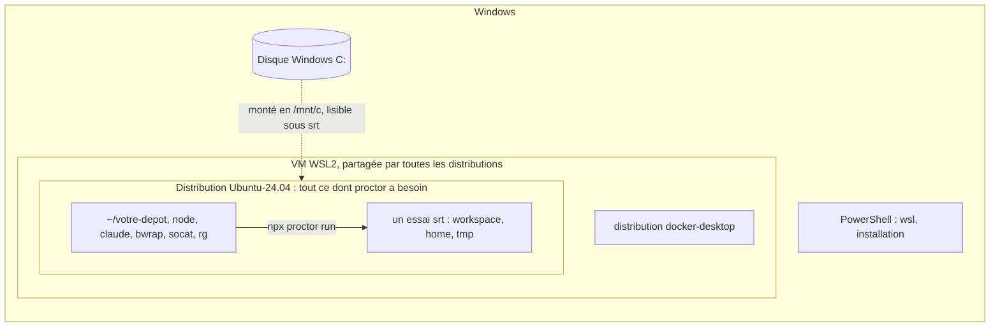

# Windows (WSL2)

proctor tourne sous Windows dans WSL2, comme sous Linux : la sandbox (bac à sable) `srt` a besoin de bubblewrap, qui n'existe que sous Linux. Sous Windows natif, `--sandbox srt` s'arrête sur `srt does not support win32: pass --sandbox local-temp (isolation degraded).`



## Ce qui a été vérifié

| Étape | Vérifiée sur | Résultat |
|---|---|---|
| Outils, première exécution, `local-temp` | conteneur `ubuntu:24.04` (arm64, `--privileged`, utilisateur non root), Node 22 de NodeSource, Claude Code 2.1.319 de l'installeur natif, proctor 0.2.1 | essai à blanc `passed` sous srt ; avec un faux token, `claude` démarre sous srt et atteint l'API (401) |
| [`/mnt/c` sous srt](#les-disques-windows-sont-lisibles-sous-srt) | même conteneur, un faux `/mnt/c` | lisible par l'essai ; le home Linux ne l'est pas |
| Installation de WSL, `wsl.conf`, Docker Desktop | documentation Microsoft et Docker seulement | **non testé sous Windows** |
| Windows natif (`local-temp`) | code source de proctor seulement | **non testé sous Windows** |

## Prérequis

| Besoin | Pourquoi |
|---|---|
| Windows 10 2004 (build 19041) ou plus récent, ou Windows 11 | `wsl --install` ([Microsoft](https://learn.microsoft.com/fr-fr/windows/wsl/install)) |
| WSL **2**, pas WSL 1 | srt lance bubblewrap, que WSL 1 ne prend pas en charge ([source de srt](https://github.com/anthropics/sandbox-runtime), [Claude Code](https://code.claude.com/docs/en/sandboxing)) |
| Abonnement Claude Pro, Max, Ultra, Team ou Enterprise | `claude setup-token` exige un abonnement ([Claude Code](https://code.claude.com/docs/en/authentication#generate-a-long-lived-token)) |
| Node.js >= 22.12, dans WSL | le Node de Windows n'est pas utilisé |

## 1. Installer WSL2 et Ubuntu

Dans PowerShell, en administrateur, puis redémarrer :

```powershell
wsl --install -d Ubuntu-24.04          # WSL2 + Ubuntu 24.04
wsl -l -v                              # VERSION must be 2
wsl --set-version Ubuntu-24.04 2       # only if it shows 1
```

Ubuntu 24.04 est la version vérifiée ici. La distribution `Ubuntu` sans version suit la dernière LTS : sur le runner GitHub `ubuntu-26.04`, srt échoue aujourd'hui (voir [Dépannage](#depannage)), et personne n'a vérifié la 26.04 sous WSL.

Ouvrez le terminal Ubuntu (menu Démarrer, ou `wsl` dans PowerShell). Toutes les commandes suivantes s'y exécutent.

## 2. Installer les outils dans WSL

```sh
sudo apt-get update
sudo apt-get install -y bubblewrap socat ripgrep git curl
bwrap --unshare-all --ro-bind / / --dev /dev --proc /proc true   # silent when bubblewrap works
curl -fsSL https://deb.nodesource.com/setup_22.x | sudo -E bash -
sudo apt-get install -y nodejs
curl -fsSL https://claude.ai/install.sh | bash
claude --version
```

- `bwrap`, `socat` et `rg` doivent être sur le `PATH` **hors de votre home** : proctor retire du `PATH` les entrées sous le home avant de les chercher. Le `rg` embarqué par Claude Code ne compte pas. apt les installe dans `/usr/bin`.
- `claude` peut rester sous le home (`~/.local/bin`) : proctor rend son répertoire réel lisible dans la sandbox.
- Si la ligne `bwrap` échoue, voir [Dépannage](#depannage).

## 3. Le token

```sh
claude setup-token                       # opens the browser, prints a one-year token
export CLAUDE_CODE_OAUTH_TOKEN=…          # in the WSL shell that runs proctor
```

- Une variable posée dans PowerShell (`$env:…`) n'est pas visible dans WSL.
- proctor passe le token à `claude` seul, jamais aux outils de l'essai : voir [Claude Code : authentification](./agents/claude-code/auth.md).
- Pour le garder d'une session à l'autre, ajoutez l'`export` à `~/.bashrc` : srt cache le home aux essais.

## 4. Cloner dans WSL

```sh
cd ~
git clone https://github.com/<org>/<repo>.git
cd <repo>
npm i -D @fluce/proctor
```

| Où | Verdict |
|---|---|
| `~/<repo>` (système de fichiers Linux) | oui |
| `/mnt/c/Users/<vous>/<repo>` (disque Windows) | non : lent, Microsoft le déconseille ([Microsoft](https://learn.microsoft.com/fr-fr/windows/wsl/filesystems)) |

Vous modifiez aussi le code dans WSL : depuis Windows, les fichiers sont sous `\\wsl$\Ubuntu-24.04\home\<vous>`.

## 5. Première exécution

Essai à blanc, sans token ni coût : il vérifie que srt démarre et que l'espace de travail est accessible en écriture ([détails](./sandboxes.md#verifier-la-sandbox-sans-modele)). Depuis un clone de proctor :

```console
$ git clone https://github.com/Luce-Florian/proctor.git && cd proctor && npm ci
$ npx proctor run examples/hello.eval.ts --agent fake --sandbox srt
Running hello: 2 trials (agent fake 0.0.0, sandbox srt, isolation full)
PASS  greets-world [baseline] #1 (257ms)
PASS  greets-world [polite] #1 (135ms)
2 trials: 2 passed, 0 failed, 0 other, 0 skipped
Wrote results/hello/2026-11-09T08-45-12-205Z-019c.ctrf.json
Wrote results/hello/2026-11-09T08-45-12-205Z-019c.summary.md
```

Puis avec le token : la [sonde d'isolation](./agents/claude-code/isolation-probe.md) lance un vrai essai Claude Code et vérifie que la sandbox tient.

```sh
npx proctor run suites/isolation-probe.eval.ts --agent claude-code
```

Dans votre projet, le même essai à blanc sur votre suite : `npx proctor run path/to/review.eval.ts --agent fake --sandbox srt`.

## Les disques Windows sont lisibles sous srt

srt cache le home Linux, `/tmp` et les autres essais. Il ne cache **pas** `/mnt` : sous WSL, l'agent peut lire `C:\` par `/mnt/c`, y compris `C:\Users\<vous>\.claude` et `.ssh`. Vérifié dans un conteneur Linux avec un faux `/mnt/c`, pas sous Windows.

Pour le fermer, dans la distribution qui lance proctor, `/etc/wsl.conf` ([Microsoft](https://learn.microsoft.com/fr-fr/windows/wsl/wsl-config)) :

```ini
# no /mnt/c
[automount]
enabled=false

# no Windows .exe from Linux, no Windows PATH
[interop]
enabled=false
appendWindowsPath=false
```

Puis `wsl --shutdown` depuis PowerShell. `/mnt/c` disparaît alors pour tout usage de cette distribution : gardez-en une seconde pour le travail courant si besoin (`wsl --list --online`, puis `wsl --install -d <distro>`). Non testé sous Windows.

## Docker Desktop

Docker Desktop tourne dans sa propre distribution `docker-desktop`, dans la même VM WSL2 qu'Ubuntu ([Docker](https://docs.docker.com/desktop/features/wsl/)). Les deux cohabitent ; ces points évitent les conflits courants.

| Point | À faire |
|---|---|
| Distribution par défaut | `wsl --set-default Ubuntu-24.04` : `wsl -l -v` affiche `*` devant Ubuntu, jamais devant `docker-desktop` |
| Docker dans Ubuntu | passer par l'intégration de Docker Desktop (Settings > Resources > WSL Integration) ; ne pas installer en plus Docker Engine dans Ubuntu ([Docker](https://docs.docker.com/desktop/features/wsl/)) |
| Mémoire | une seule VM pour toutes les distributions : Docker et les essais la partagent. `memory=` dans `%UserProfile%\.wslconfig`, 50 % de la RAM par défaut ([Microsoft](https://learn.microsoft.com/fr-fr/windows/wsl/wsl-config)) ; baissez `-j` si les essais manquent de mémoire |
| `wsl --shutdown` | arrête aussi Docker Desktop : nécessaire après une modification de `wsl.conf` |
| proctor dans un conteneur | non : bubblewrap exige un conteneur privilégié, et proctor ne propose pas le mode imbriqué affaibli de srt |
| `docker` appelé par l'agent | pas sous srt : Claude Code documente `docker` comme incompatible avec la sandbox ([Claude Code](https://code.claude.com/docs/en/sandboxing)) |

proctor n'a pas besoin de Docker. Aucun conflit n'a été reproduit : ce tableau vient de la documentation, pas d'un test sous Windows.

## Sans WSL

| Option | Isolation | État |
|---|---|---|
| Windows natif, `--sandbox srt` | — | refusé par proctor : `srt does not support win32` |
| Windows natif, `--sandbox local-temp` | `degraded` : l'agent lit tout le disque, écrit partout, atteint tout domaine | **non testé sous Windows** ; d'après le code, proctor cherche `claude` sans l'extension `.exe`, donc il ne trouve probablement pas une installation native |
| srt natif pour Windows (alpha) | compte Windows et pare-feu, pas bubblewrap | livré dans `@anthropic-ai/sandbox-runtime` (`windows-install`), **pas branché dans proctor** |
| WSL 1 | — | pas de srt |

Ce que `local-temp` garde, sur tout OS : un `HOME` et un `CLAUDE_CONFIG_DIR` temporaires, les réglages, serveurs MCP et plugins de l'hôte non chargés (`--setting-sources user`, `--strict-mcp-config`), la [sonde d'init](./agents/claude-code/isolation-probe.md#sonde-d-init). Ce qu'il perd : l'agent peut toujours lire le vrai `~/.claude` (mémoire, `CLAUDE.md`) par son chemin absolu, et atteindre le réseau. La sonde d'isolation y échoue, à dessein.

## Dépannage

| Symptôme | Cause | Correction |
|---|---|---|
| `srt does not support win32` | proctor est lancé depuis PowerShell ou CMD | le lancer dans le terminal WSL |
| `srt needs socat on PATH (outside your home directory)` | outil absent, ou installé sous le home (`~/.local/bin`, `~/.cargo/bin`) | `sudo apt-get install -y bubblewrap socat ripgrep` |
| la ligne `bwrap --unshare-all …` échoue | espaces de noms utilisateur restreints, comme sur les runners GitHub Ubuntu 24.04 ; non vérifié sous WSL | `sudo sysctl -w kernel.apparmor_restrict_unprivileged_userns=0` |
| `apply-seccomp: write /proc/self/setgroups (nested userns is capability-restricted; caller must provide CAP_SYS_ADMIN)` | vu sur le runner GitHub `ubuntu-26.04` avec srt 0.0.78, sysctl ci-dessus appliqué ; non vérifié sous WSL | pas encore de correctif : utiliser Ubuntu 24.04 |
| `"claude" not found on PATH` | Claude Code installé seulement sous Windows | l'installer dans WSL ; `which -a claude` doit afficher un chemin Linux, pas `/mnt/c/…` |
| `No credential for claude-code` | token exporté dans un autre shell, ou dans PowerShell | `export CLAUDE_CODE_OAUTH_TOKEN=…` dans le shell WSL |
| `claude refused the credential CLAUDE_CODE_OAUTH_TOKEN` | token invalide ou expiré | relancer `claude setup-token` |
| `The sandbox did not run a command in the workspace` | srt démarre mais la commande échoue ; l'erreur de srt suit | lire cette erreur ; relancer la vérification `bwrap` |
