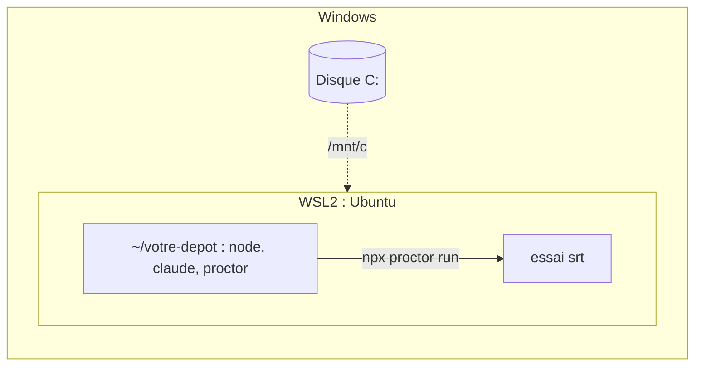

# Windows (WSL2)

Lancez proctor dans WSL2. La sandbox (bac à sable) `srt` a besoin de bubblewrap, qui n'existe que sous Linux : proctor refuse Windows natif (`srt does not support win32`).



## Prérequis

| Besoin | Pourquoi |
|---|---|
| Windows 10 2004 (build 19041) ou plus récent, ou Windows 11 | `wsl --install` ([Microsoft](https://learn.microsoft.com/fr-fr/windows/wsl/install)) |
| WSL **2**, pas WSL 1 | WSL 1 ne peut pas lancer bubblewrap |
| Abonnement Claude Pro, Max, Ultra, Team ou Enterprise | `claude setup-token` exige un abonnement ([Claude Code](https://code.claude.com/docs/en/authentication#generate-a-long-lived-token)) |

## 1. Installer WSL2 et Ubuntu

Dans PowerShell, en administrateur, puis redémarrez :

```powershell
wsl --install -d Ubuntu-24.04
wsl -l -v                              # VERSION must be 2
```

Ouvrez le terminal Ubuntu. Lancez toutes les commandes suivantes dedans.

## 2. Installer les outils dans WSL

```sh
sudo apt-get update
sudo apt-get install -y bubblewrap socat ripgrep git curl
curl -fsSL https://deb.nodesource.com/setup_22.x | sudo -E bash -
sudo apt-get install -y nodejs
curl -fsSL https://claude.ai/install.sh | bash
```

- Node doit être >= 22.12, installé dans WSL. Le Node de Windows n'est pas utilisé.
- Installez `bwrap`, `socat` et `rg` par apt : proctor ignore les entrées du `PATH` sous votre home.

## 3. Créer un token

```sh
claude setup-token
echo 'export CLAUDE_CODE_OAUTH_TOKEN=…' >> ~/.bashrc
source ~/.bashrc
```

Posez le token dans le shell WSL. Une variable posée dans PowerShell n'est pas visible dans WSL. Voir [Claude Code : authentification](./agents/claude-code/auth.md).

## 4. Travailler dans le système de fichiers Linux

```sh
cd ~
git clone https://github.com/<org>/<repo>.git
cd <repo>
npm i -D @fluce/proctor
```

Gardez vos dépôts sous `~`, pas sous `/mnt/c` : le disque Windows est lent depuis WSL ([Microsoft](https://learn.microsoft.com/fr-fr/windows/wsl/filesystems)). Depuis Windows, ouvrez-les sous `\\wsl$\Ubuntu-24.04\home\<vous>`.

## 5. Lancer une première éval

```sh
npx proctor run path/to/review.eval.ts --agent claude-code
```

Pour vérifier d'abord la sandbox, lancez la [sonde d'isolation](./agents/claude-code/isolation-probe.md) depuis un clone de proctor.

## Sécurité : les disques Windows restent lisibles

srt cache le home Linux et `/tmp`, pas `/mnt`. Un essai peut lire `C:\` par `/mnt/c`, y compris `C:\Users\<vous>\.claude` et `.ssh`.

Faites l'un ou l'autre :

- ne gardez aucun secret sur les disques Windows ;
- ou désactivez le montage automatique dans la distribution qui lance proctor, dans `/etc/wsl.conf` ([Microsoft](https://learn.microsoft.com/fr-fr/windows/wsl/wsl-config)), puis lancez `wsl --shutdown` depuis PowerShell.

```ini
[automount]
enabled=false

[interop]
enabled=false
appendWindowsPath=false
```

`/mnt/c` disparaît alors pour tout usage de la distribution. Gardez-en une seconde pour le travail courant si besoin.

## Dépannage

| Symptôme | Correction |
|---|---|
| `srt does not support win32` | lancez proctor dans le terminal WSL, pas dans PowerShell ou CMD |
| `srt needs socat on PATH (outside your home directory)` | `sudo apt-get install -y bubblewrap socat ripgrep` |
| `"claude" not found on PATH` | installez Claude Code dans WSL : `which -a claude` doit afficher un chemin Linux, pas `/mnt/c/…` |
