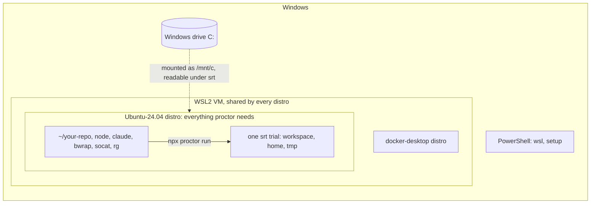

# Windows (WSL2)

proctor runs on Windows inside WSL2, as on Linux: the `srt` sandbox needs bubblewrap, which only exists on Linux. On native Windows, `--sandbox srt` stops with `srt does not support win32: pass --sandbox local-temp (isolation degraded).`



## What was checked

| Step | Checked on | Result |
|---|---|---|
| Tools, first run, `local-temp` | `ubuntu:24.04` container (arm64, `--privileged`, non-root user), Node 22 from NodeSource, Claude Code 2.1.319 from the native installer, proctor 0.2.1 | dry run `passed` under srt; with a fake token, `claude` starts under srt and reaches the API (401) |
| [`/mnt/c` under srt](#windows-drives-are-readable-under-srt) | same container, a fake `/mnt/c` | readable by the trial; the Linux home is not |
| WSL install, `wsl.conf`, Docker Desktop | Microsoft and Docker documentation only | **not tested on Windows** |
| Native Windows (`local-temp`) | proctor source code only | **not tested on Windows** |

## Prerequisites

| Need | Why |
|---|---|
| Windows 10 2004 (build 19041) or later, or Windows 11 | `wsl --install` ([Microsoft](https://learn.microsoft.com/en-us/windows/wsl/install)) |
| WSL **2**, not WSL 1 | srt runs bubblewrap, which WSL 1 does not support ([srt source](https://github.com/anthropics/sandbox-runtime), [Claude Code](https://code.claude.com/docs/en/sandboxing)) |
| Claude Pro, Max, Ultra, Team or Enterprise plan | `claude setup-token` needs a subscription ([Claude Code](https://code.claude.com/docs/en/authentication#generate-a-long-lived-token)) |
| Node.js >= 22.12, inside WSL | the Windows Node is not used |

## 1. Install WSL2 and Ubuntu

In PowerShell, as administrator, then restart:

```powershell
wsl --install -d Ubuntu-24.04          # WSL2 + Ubuntu 24.04
wsl -l -v                              # VERSION must be 2
wsl --set-version Ubuntu-24.04 2       # only if it shows 1
```

Ubuntu 24.04 is the version checked here. The plain `Ubuntu` distro follows the latest LTS: on the GitHub `ubuntu-26.04` runner, srt currently fails (see [Troubleshooting](#troubleshooting)), and nobody has checked 26.04 under WSL.

Open the Ubuntu terminal (Start menu, or `wsl` in PowerShell). Every following command runs there.

## 2. Install the tools in WSL

```sh
sudo apt-get update
sudo apt-get install -y bubblewrap socat ripgrep git curl
bwrap --unshare-all --ro-bind / / --dev /dev --proc /proc true   # silent when bubblewrap works
curl -fsSL https://deb.nodesource.com/setup_22.x | sudo -E bash -
sudo apt-get install -y nodejs
curl -fsSL https://claude.ai/install.sh | bash
claude --version
```

- `bwrap`, `socat` and `rg` must be on `PATH` **outside your home**: proctor drops the `PATH` entries under the home before it looks for them. The `rg` bundled with Claude Code does not count. apt installs them in `/usr/bin`.
- `claude` may stay under the home (`~/.local/bin`): proctor makes its real directory readable in the sandbox.
- If the `bwrap` line fails, see [Troubleshooting](#troubleshooting).

## 3. The token

```sh
claude setup-token                       # opens the browser, prints a one-year token
export CLAUDE_CODE_OAUTH_TOKEN=…          # in the WSL shell that runs proctor
```

- A variable set in PowerShell (`$env:…`) is not visible in WSL.
- proctor passes the token to `claude` alone, never to the trial's tools: see [Claude Code: auth](./agents/claude-code/auth.md).
- To keep it across sessions, add the `export` to `~/.bashrc`: srt hides the home from the trials.

## 4. Clone in WSL

```sh
cd ~
git clone https://github.com/<org>/<repo>.git
cd <repo>
npm i -D @fluce/proctor
```

| Where | Verdict |
|---|---|
| `~/<repo>` (Linux file system) | yes |
| `/mnt/c/Users/<you>/<repo>` (Windows drive) | no: slow, Microsoft recommends against it ([Microsoft](https://learn.microsoft.com/en-us/windows/wsl/filesystems)) |

You edit the code in WSL too: from Windows, the files are under `\\wsl$\Ubuntu-24.04\home\<you>`.

## 5. First run

Dry run, no token and no cost: it checks that srt starts and that the workspace is writable ([details](./sandboxes.md#checking-the-sandbox-without-a-model)). From a clone of proctor:

```console
$ git clone https://github.com/Luce-Florian/proctor.git && cd proctor && npm ci
$ npx proctor run examples/hello.eval.ts --agent fake --sandbox srt
Running hello: 2 trials (agent fake 0.0.0, sandbox srt, isolation full)
PASS  greets-world [baseline] #1 (257ms)
PASS  greets-world [polite] #1 (135ms)
2 trials: 2 passed, 0 failed, 0 other, 0 skipped
Wrote results/hello/2026-11-09T08-45-12-205Z-019c.ctrf.json
Wrote results/hello/2026-11-09T08-45-12-205Z-019c.summary.md
```

Then with the token: the [isolation probe](./agents/claude-code/isolation-probe.md) runs one real Claude Code trial and checks that the sandbox holds.

```sh
npx proctor run suites/isolation-probe.eval.ts --agent claude-code
```

In your own project, the same dry run on your suite: `npx proctor run path/to/review.eval.ts --agent fake --sandbox srt`.

## Windows drives are readable under srt

srt hides the Linux home, `/tmp` and the other trials. It does **not** hide `/mnt`: under WSL, the agent can read `C:\` through `/mnt/c`, including `C:\Users\<you>\.claude` and `.ssh`. Checked in a Linux container with a fake `/mnt/c`, not on Windows.

To close it, in the distro that runs proctor, `/etc/wsl.conf` ([Microsoft](https://learn.microsoft.com/en-us/windows/wsl/wsl-config)):

```ini
# no /mnt/c
[automount]
enabled=false

# no Windows .exe from Linux, no Windows PATH
[interop]
enabled=false
appendWindowsPath=false
```

Then `wsl --shutdown` from PowerShell. This removes `/mnt/c` for every use of that distro: keep a second distro for daily work if you need it (`wsl --list --online`, then `wsl --install -d <distro>`). Not tested on Windows.

## Docker Desktop

Docker Desktop runs in its own `docker-desktop` distro, in the same WSL2 VM as Ubuntu ([Docker](https://docs.docker.com/desktop/features/wsl/)). They coexist; these points avoid the usual clashes.

| Point | Do |
|---|---|
| Default distro | `wsl --set-default Ubuntu-24.04`: `wsl -l -v` shows `*` next to Ubuntu, never next to `docker-desktop` |
| Docker in Ubuntu | use the Docker Desktop integration (Settings > Resources > WSL Integration); do not also install Docker Engine in Ubuntu ([Docker](https://docs.docker.com/desktop/features/wsl/)) |
| Memory | one VM for every distro: Docker and the trials share it. `memory=` in `%UserProfile%\.wslconfig`, default 50% of the RAM ([Microsoft](https://learn.microsoft.com/en-us/windows/wsl/wsl-config)); lower `-j` if trials run out of memory |
| `wsl --shutdown` | stops Docker Desktop too: needed after a `wsl.conf` change |
| proctor inside a container | no: bubblewrap needs a privileged container, and proctor does not offer srt's weaker nested mode |
| `docker` called by the agent | not under srt: Claude Code documents `docker` as incompatible with the sandbox ([Claude Code](https://code.claude.com/docs/en/sandboxing)) |

proctor does not need Docker. No conflict was reproduced: this table comes from the documentation, not from a Windows test.

## Without WSL

| Option | Isolation | Status |
|---|---|---|
| Native Windows, `--sandbox srt` | — | refused by proctor: `srt does not support win32` |
| Native Windows, `--sandbox local-temp` | `degraded`: the agent reads the whole disk, writes anywhere, reaches any domain | **not tested on Windows**; from the code, proctor looks for `claude` without the `.exe` extension, so it probably does not find a native install |
| srt native for Windows (alpha) | Windows account and firewall, not bubblewrap | shipped in `@anthropic-ai/sandbox-runtime` (`windows-install`), **not wired into proctor** |
| WSL 1 | — | no srt |

What `local-temp` keeps, on every OS: a temporary `HOME` and `CLAUDE_CONFIG_DIR`, the host settings, MCP servers and plugins not loaded (`--setting-sources user`, `--strict-mcp-config`), the [init probe](./agents/claude-code/isolation-probe.md#init-probe). What it loses: the agent can still read the real `~/.claude` (memory, `CLAUDE.md`) by its absolute path, and reach the network. The isolation probe fails there, by design.

## Troubleshooting

| Symptom | Cause | Fix |
|---|---|---|
| `srt does not support win32` | proctor runs from PowerShell or CMD | run it in the WSL terminal |
| `srt needs socat on PATH (outside your home directory)` | tool missing, or installed under the home (`~/.local/bin`, `~/.cargo/bin`) | `sudo apt-get install -y bubblewrap socat ripgrep` |
| the `bwrap --unshare-all …` line fails | user namespaces restricted, as on the GitHub Ubuntu 24.04 runners; not checked on WSL | `sudo sysctl -w kernel.apparmor_restrict_unprivileged_userns=0` |
| `apply-seccomp: write /proc/self/setgroups (nested userns is capability-restricted; caller must provide CAP_SYS_ADMIN)` | seen on the GitHub `ubuntu-26.04` runner with srt 0.0.78, sysctl above applied; not checked on WSL | no fix known yet: use Ubuntu 24.04 |
| `"claude" not found on PATH` | Claude Code installed on Windows only | install it in WSL; `which -a claude` must show a Linux path, not `/mnt/c/…` |
| `No credential for claude-code` | token exported in another shell, or in PowerShell | `export CLAUDE_CODE_OAUTH_TOKEN=…` in the WSL shell |
| `claude refused the credential CLAUDE_CODE_OAUTH_TOKEN` | token invalid or expired | run `claude setup-token` again |
| `The sandbox did not run a command in the workspace` | srt starts but the command fails; srt's own error follows | read that error; rerun the `bwrap` check |
