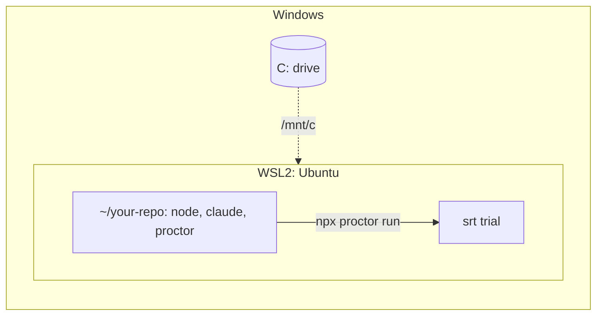

# Windows (WSL2)

Run proctor inside WSL2. The `srt` sandbox needs bubblewrap, which only exists on Linux: proctor refuses native Windows (`srt does not support win32`).



## Prerequisites

| Need | Why |
|---|---|
| Windows 10 2004 (build 19041) or later, or Windows 11 | `wsl --install` ([Microsoft](https://learn.microsoft.com/en-us/windows/wsl/install)) |
| WSL **2**, not WSL 1 | WSL 1 cannot run bubblewrap |
| Claude Pro, Max, Ultra, Team or Enterprise plan | `claude setup-token` needs a subscription ([Claude Code](https://code.claude.com/docs/en/authentication#generate-a-long-lived-token)) |

## 1. Install WSL2 and Ubuntu

In PowerShell, as administrator, then restart:

```powershell
wsl --install -d Ubuntu-24.04
wsl -l -v                              # VERSION must be 2
```

Open the Ubuntu terminal. Run every following command there.

## 2. Install the tools in WSL

```sh
sudo apt-get update
sudo apt-get install -y bubblewrap socat ripgrep git curl
curl -fsSL https://deb.nodesource.com/setup_22.x | sudo -E bash -
sudo apt-get install -y nodejs
curl -fsSL https://claude.ai/install.sh | bash
```

- Node must be >= 22.12, installed in WSL. The Windows Node is not used.
- Install `bwrap`, `socat` and `rg` with apt: proctor ignores the `PATH` entries under your home.

## 3. Create a token

```sh
claude setup-token
echo 'export CLAUDE_CODE_OAUTH_TOKEN=…' >> ~/.bashrc
source ~/.bashrc
```

Set the token in the WSL shell. A variable set in PowerShell is not visible in WSL. See [Claude Code: auth](./agents/claude-code/auth.md).

## 4. Work in the Linux file system

```sh
cd ~
git clone https://github.com/<org>/<repo>.git
cd <repo>
npm i -D @fluce/proctor
```

Keep your repos under `~`, not under `/mnt/c`: the Windows drive is slow from WSL ([Microsoft](https://learn.microsoft.com/en-us/windows/wsl/filesystems)). From Windows, open them under `\\wsl$\Ubuntu-24.04\home\<you>`.

## 5. Run a first eval

```sh
npx proctor run path/to/review.eval.ts --agent claude-code
```

To check the sandbox first, run the [isolation probe](./agents/claude-code/isolation-probe.md) from a clone of proctor.

## Security: Windows drives stay readable

srt hides the Linux home and `/tmp`, not `/mnt`. A trial can read `C:\` through `/mnt/c`, including `C:\Users\<you>\.claude` and `.ssh`.

Do one of these:

- keep no secrets on the Windows drives;
- or disable the automount in the distro that runs proctor, in `/etc/wsl.conf` ([Microsoft](https://learn.microsoft.com/en-us/windows/wsl/wsl-config)), then run `wsl --shutdown` from PowerShell.

```ini
[automount]
enabled=false

[interop]
enabled=false
appendWindowsPath=false
```

This removes `/mnt/c` for every use of the distro. Keep a second distro for daily work if you need it.

## Troubleshooting

| Symptom | Fix |
|---|---|
| `srt does not support win32` | run proctor in the WSL terminal, not in PowerShell or CMD |
| `srt needs socat on PATH (outside your home directory)` | `sudo apt-get install -y bubblewrap socat ripgrep` |
| `"claude" not found on PATH` | install Claude Code in WSL: `which -a claude` must show a Linux path, not `/mnt/c/…` |
